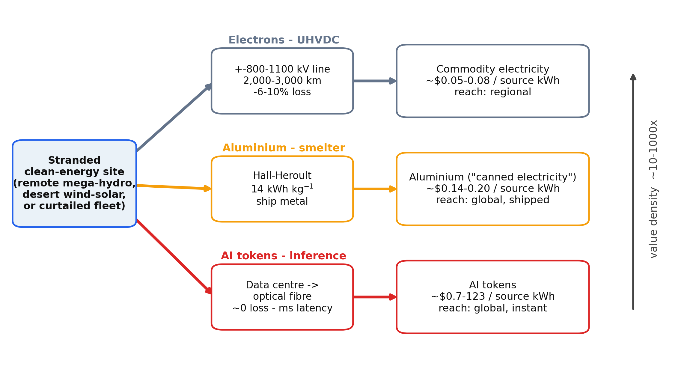
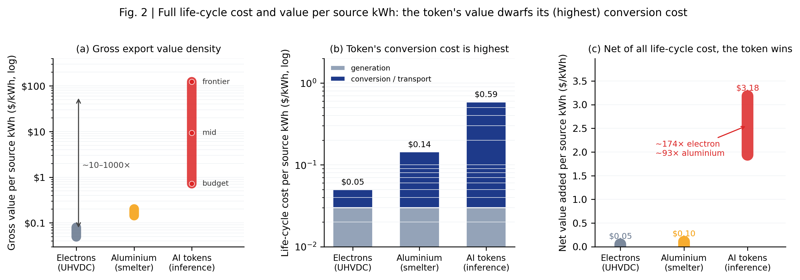
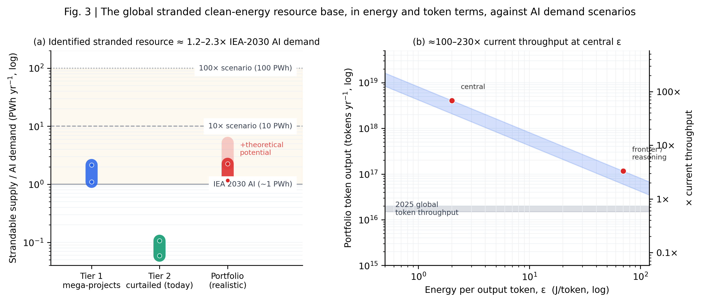
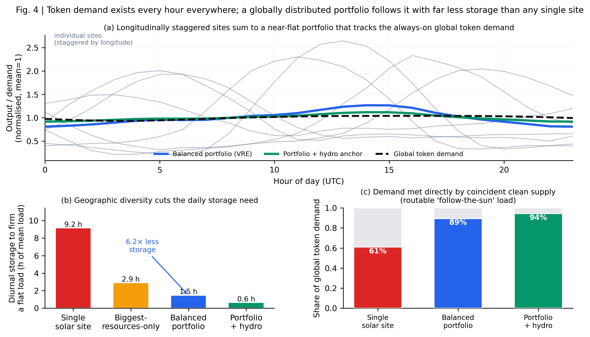
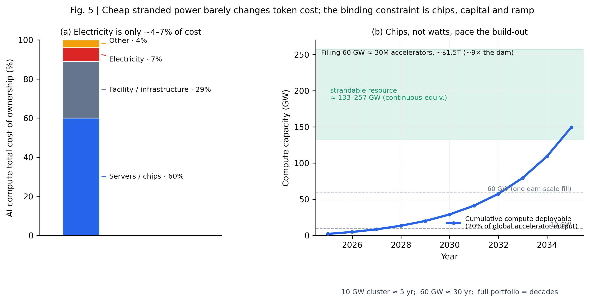
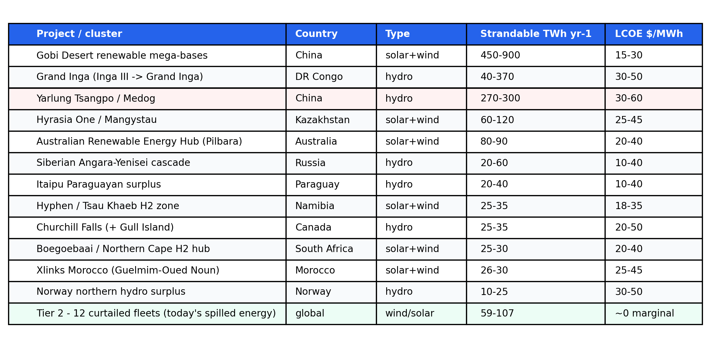

# 以全球 token 经济唤醒世界尚未开发的巨型能源资源

*（英文标题：Waking the world's untapped mega-energy resources through the global token economy）*

*Perspective 中文稿 v2（对应英文稿 [Manuscript_NatureEnergy_Perspective_v2_EN.md](Manuscript_NatureEnergy_Perspective_v2_EN.md)，同结构、同数字）。按* Nature Energy *体例：正文 ≤3,000 词级；非结构化摘要、正文不堆引用；参考文献 ≤50 条并对最重要者加注"意义说明"；展示项 ≤6（图 1 概念图；图 2–5；Box 1）。所有定量结果由 `analysis/` 流水线（M1 组合/需求、M2 逐小时时间匹配、M3 芯片约束）生成、写入 `data/*_results.json`，并以区间陈述。关键对照论文为 Zhu 等，《Desert power for the AI era》，* Nexus *(2026)。标 ⚠ 的引用投稿前须替换为一手文献。*

**作者：** [作者一]¹、[作者二]²　**单位：** ¹…；²…　**通讯作者：** …

---

## 摘要

最清洁、最廉价的电力，正越来越多地被建在几乎无人能消纳的地方：偏远的巨型水电、沙漠风光，以及因结构性弃电而被压减出力的风光电站——这些资源被搁浅或弃掉的电量加总起来，已达到一个主要经济体全年用电的量级。人们不假思索的惯常答案，是把电子经数千公里高损耗的特高压线路送出去。我们在此提出：对其中一大类资源而言，最高价值的出口不是电子，而是人工智能（AI）的 token——在资源所在地部署推理算力，再将其产出经光纤送出。一度电以 token 形态封装的可出口价值，可比同一度电以电子外送、或封装为铝高出一到三个数量级。我们把一个全球搁浅资源组合与若干 AI 需求情景相对照，并把逐小时的清洁供给与遍布全球、全天候不间断的 token 负荷相匹配，结果表明：该资源基底与它所能服务的需求处于同一量级，而一个沿经度分布的资源组合，能以远少于任何单一站点的储能去跟随全球负荷。真正的约束并非能源，而是芯片。

---

## 正文

在世界各地，成本最低的清洁能源正被建在无人消纳之处。中国的雅鲁藏布江工程将在一处喜马拉雅峡谷中年发电约 300 TWh——约为三峡的三倍——而该地距负荷中心在 2000 公里以上¹,²。但它只是这一全球性格局中最为极端、最引人注目的一例。刚果河上的大英加（Grand Inga）、从皮尔巴拉（Pilbara）到哈萨克斯坦到纳米比亚的沙漠风光外送枢纽、以及戈壁可再生能源大基地，各自在远离负荷之处汇聚了数十到数百 TWh 的发电量；与此同时，中国西部、西得克萨斯、智利北部、南澳与苏格兰**既有的**风光电站，每年已以弃电的形式弃掉两位数 TWh 的电量³,⁴。常规框架把这一切都当作一个用更多线路去解决的输电问题。这一框架并非错误，但它正日益成为**错误的默认**。

孕育出这些资源的同一个十年，也孕育出一种对"在何处用电"异常不敏感的工业用电需求——只要其产出能以信息而非电流的形式被搬运。全球数据中心与 AI 用电正陡峭上升⁵，而 AI 售卖其产出的计量单位——token——既在总量上变得巨大，也第一次在能耗强度上变得可被可信地度量⁶,⁷。一项近期的全球优化研究表明，离网的沙漠风-光-储系统能以 39–46 美元/MWh 向就地共址的数据中心交付稳定的 24/7 电力，足以满足国际能源署（IEA）对 2030 年 AI 需求的预测乃至更高⁸。该工作确立了供给侧的可行性。我们在此提出一篇 Perspective 理应回答的、层次更高的互补问题：世界上**哪些**搁浅资源是候选；它们与可信需求**如何**对比；为何 token——而非电子——是价值最大化的出口；一个全球分布的算力机群如何匹配一个"全球且连续"的需求；以及，真正限制其建设的是什么。

我们提出四个定量主张，每一个都锚定于一项明确计算（见方法；`analysis/`）：就每源千瓦时而言，token 所携带的可出口价值比电子或金属高出一到三个数量级（图 2）；已识别的全球搁浅清洁能源组合与 AI 需求预测处于同一量级——是与之比肩，而非数倍于之（图 3、Box 1）；由于 token 需求无处不在、每时刻都有，一个沿经度分布的组合可以用远少于任何单一站点的储能去跟随它（图 4）；而要实现以上一切，决定性约束是芯片与资本，而非瓦特（图 5）。

**图 1 ｜ 一个搁浅能源站点的三条出口路径。** 一个搁浅的瓦特可以电子离场（特高压线：高损、重资本、半径短、价值低）、以金属离场（铝："罐装电力"、可运、价值中等）、或以 token 离场（光纤：运输近零损耗、全球可达、价值密度最高）。概念示意图。

### Token 为何胜出：全生命周期成本与价值

远距离输电是一项工程奇迹，但作为**为一个没有本地市场的资源变现**的手段，它却是一个糟糕的默认选项：±800 千伏特高压直流线路在 2000–3000 公里上损失 6–10%⁹,¹⁰；其固定资本使每度送达成本与利用率成反比³；所交付的不过是赤裸的大宗商品——每度电在远端仅值约 0.05–0.08 美元，且前提是存在买家¹¹；而线路本身从核准到建成需近十年，并网排队中等待接入的发电与储能已超过 2 太瓦¹²——相比之下，一座数据机房可在数月内通电，并随资源逐步扩容。一个世纪之久的替代方案是出口高耗能的**产品**：原铝，其 Hall–Héroult 电解每千克耗电约 13–16 千瓦时，使得电力约占金属成本的 40%，铝锭实质上就是"罐装电力"¹³——这正是冶炼厂从挪威到冰岛被刻意建在原本无法外销的水电旁的原因¹³,¹⁴。我们提出，数据中心是现代冶炼厂，token 是价值密度高得多的现代铝锭，并有一处发人深省的反转：电力占铝成本约 40%，却仅占算力成本约 4–7%⁶，故廉价电对 token 业务的意义较小——但也正因如此，该业务面对能源价格波动是**稳健**而非脆弱的，其决定性优势在于搁浅资源所独有地提供的两样东西：大量本会被弃掉的清洁电力，以及免于大规模输电建设——那正是以电子出口所必需的。

从**全生命周期**的角度看，token 的优势最为清晰（图 2）。就每源千瓦时而言，各路径所能封装的**总**价值相差一到三个数量级：以电子出口约 0.05–0.08 美元⁹,¹¹，以铝出口约 0.14–0.20 美元¹³，以 token 出口则从廉价档到前沿档为约 0.7 至约 123 美元⁶,⁷（图 2a）。token 每源千瓦时的全生命周期**成本**，平心而论确是三者中最高的——约 0.4–0.7 美元，因为芯片与设施主导算力成本、而电力仅占约 4–7%⁶（图 2b）；这一资本密集度正是我们下文要回到的决定性约束，而非"瓦特"本身的属性。然而，正因为所创造的价值大得多，每源千瓦时的**净增加值**——总产出价值减去全部非能源全生命周期成本——仍决定性地偏向 token：在廉价、主流与前沿三类工况下约为 2–3 美元，对照电子或金属的近零至约 0.11 美元，即便计入 token 高昂的转化成本，这一约一到两个数量级（≈90–170 倍）的优势依然成立（图 2c）。token 的胜出不在于生产成本低，而在于它能从每一个本会搁浅的瓦特中创造出多得多的可出口价值。

**图 2 ｜ 每源千瓦时的全生命周期成本与价值。** （a）总出口价值密度（对数），每条路径均扫描其产出价格：电子约 0.05–0.08 美元、铝约 0.14–0.20 美元、token 在高效 ε 下从廉价到前沿定价约 0.7–123 美元——相差一到三个数量级。（b）每源千瓦时的全生命周期成本：token 的转化成本（约 0.5 美元）是三者中最高的，因为芯片与设施主导、而电力仅占约 4–7%。（c）跨代表性工况档的每源千瓦时净增加值（毛价值减去非能源全生命周期成本）：token 约 2–3 美元，对照电子或金属的近零至约 0.11 美元——约一到两个数量级（≈90–170 倍）的优势。

### 资源基底与需求的对比

机会有多大？我们组建了一个分层的大型搁浅清洁能源组合（Box 1；`data/portfolio.csv`），并按一个就地共址的算力终端真正需要的标准筛选——容量因子、冷却气候、到光纤登陆点的时延、以及到基础设施的距离——所用方法沿袭参考文献 8 的沙漠资源评估。**Tier 1** 为离散巨型项目：偏远巨型水电（雅鲁藏布江约 270–300 TWh/年；大英加约 40–370；西伯利亚安加拉—叶尼塞梯级；丘吉尔瀑布）与规划中的沙漠外送枢纽（戈壁大基地约 450–900；皮尔巴拉约 80–90；Hyrasia 约 60–120；Hyphen 约 25–35）。**Tier 2** 为**既有的**、其产出今日已被弃掉的可再生能源电站，弃电的边际价值近乎为零。

已识别的 Tier 1 资源合计约 1,100–2,150 TWh/年的可搁浅电量，Tier 2 再添约 60–110 TWh/年今日正被弃掉的电量（图 3a）——合计约 1.2–2.3 PWh/年，理论沙漠潜力还要再大数倍⁸。客观地解读，这里刻意不作夸张：这与 IEA 对 2030 年 AI 用电约 1 PWh/年的预测处于同一量级——约为其 1.2–2.3 倍，约为激进的 10 PWh 情景的 12–23%⁸。按中值能耗换算为 token，同一组合所能封装的 token 量约为全世界 2025 年 token 总吞吐量的 100–230 倍（图 3b）；但这个倍数由主导性不确定量——单 token 能耗 ε，实测跨越约 0.15–120 焦⁶,⁷——所决定，应始终以区间陈述。我们的主张不是"单一资源压倒全世界"，而是：全球搁浅基底与它所能服务的需求**处于同一数量级**——于是，"下一批吉瓦级算力建在何处"的决定，隐含地就是"哪些搁浅的瓦特被变现"的决定。

**图 3 ｜ 搁浅资源基底（以能源与 token 两种口径）对照 AI 需求情景。** （a）按 Tier 的可搁浅供给（PWh/年，对数）对照 IEA-2030、10× 与 100× 需求线，以及沙漠风-光-储可交付带⁸。（b）现实组合的 token 产出随 ε 的变化，叠加 2025 年全球吞吐带；右轴为当前吞吐量的倍数。

### Token 需求是全球且连续的——故应分散供给

单一站点只看见自己的日照与风；而全世界的 token 需求并不受制于任何单一站点的日照或风况。推理在每个时区、全天候被消纳，其聚合的昼夜摆动远比任一地区更平缓，因为各地区的峰值被经度错开（我们构造的全球需求包络其峰均比仅约 1.04；见方法）。这是供给问题的镜像，并指向一个不同于"用储能把每个站点各自做成 24/7"⁸ 的解法：把供给沿经度分散开来，使**组合**——而非任何单一站点——去跟随这个遍布全球的负荷。

我们用跨越 −102° 至 +138° 经度的代表性站点的真实逐小时容量因子（ERA5 再分析¹⁵；见方法），发现这一效应很大（图 4）。一个以光伏为主的单一站点其昼夜峰均比约为 2.6，要使其稳定供应一个平直负荷需约 9 小时的均荷储能；而由同一批站点构成的、地理上均衡的组合则降至约 1.3 与约 1.5 小时——日内储能需求减少约 6 倍——因为一个地区的午后正是另一个地区的午夜。对于一个**可灵活路由**、对时延不敏感、能够追随富余清洁电力的工作负载，全球全天候不间断的 token 需求中约 89% 可由同时段的清洁供给直接满足、完全无需储能；若组合中含一个稳定的水电锚点，则升至约 94%。地理均衡本身就是一个设计杠杆：一个只向最大资源（它们恰好聚集于东半球）倾斜的组合平滑得更少，需约 2.9 而非约 1.5 小时。一个多周尺度的**季节性**残差仍然存在——这是真正的局限——它不靠电池、而靠组合中稳定的水电成员与"让可批处理利用率随季节弹性变化"来承担。

**图 4 ｜ token 需求无处不在、每时刻都有；一个全球分散的组合以远少于任何单站的储能去跟随它。** （a）平均 UTC 日内：被经度错开的各站点（灰）叠加为近乎平直的组合（蓝/绿），跟随全天候的全球需求（虚线）。（b）做稳一个平直负荷所需的日内储能。（c）由同时段清洁供给直接满足的全球需求份额（可路由的"追日"负载）。

### 真正的约束是芯片，而非瓦特

那套让廉价电沦为次要成本优势的算术，也重置了约束之所在。由于芯片与服务器约占算力拥有成本的 60%、而电力仅约 4–7%⁶（图 5a），廉价搁浅电只能温和地改善利润；它消除的是**输电**问题，而非**硬件**问题。按每张高端加速器约 2 千瓦的机房级功率¹⁶，约 1.2–2.3 PWh/年的组合相当于约 130–260 吉瓦的连续算力——需要约 6500 万到 1.3 亿张加速器。对照全球高端加速器约 400–500 万张/年的产量（2023 年约 376 万张数据中心 GPU），且受先进封装产能所限、虽在增长¹⁷——即便把世界产量的五分之一拨给搁浅站点，每年也只能部署约 2 吉瓦算力。于是单个 10 吉瓦集群需约 5 年；填满 60 吉瓦需约 30 年、约 3000 万张加速器、约 1.5 万亿美元（约为大坝的 9 倍）；而填满整个资源基底则是一个数十年的尺度（图 5b）。因此先行者必然适度——数吉瓦与一个弃电资源就地共址，而非一次填满一座大坝。搁浅的瓦特是充裕的；消纳它的芯片才是稀缺的投入。

**图 5 ｜ 廉价搁浅电几乎不改变 token 成本；决定性约束是芯片、资本与爬坡。** （a）算力拥有成本：芯片约 60%、设施约 29%、电力仅约 4–7%⁶。（b）按全球加速器产量 20% 份额可累计部署的算力对照可搁浅资源带；单个 10 吉瓦集群需约 5 年，填满整个组合需数十年。

### 什么必须成立，什么不必

该模式适配一大类且仍在增长的工作负载，且其条件已被若干资源满足。**可批处理、容时延**的工作——大规模预训练、批量推理与链式推理（reasoning inference）、合成数据生成、agentic 后台任务——并不取决于贴近用户，且仅推理类工况到 2025 年底就已超过用量的一半⁶。光纤增加的能耗可忽略，每千公里仅增数十毫秒时延，这类负载轻松容忍；寒冷与高海拔站点对冷却异常有利¹⁸；而比特币挖矿早已证明，算力会作为"最后买家"迁向伴生气、弃水电与过剩风电¹⁹。至于"为何不干脆建在需求侧"，其自然的回应正是适用范围的界定：时延敏感与数据驻留型工作负载应当、也将会留在用户附近——我们的主张只是，那**可批处理**的一部分有一个强而被低估的理由迁向搁浅能源，且一流资源应在规划时把这一选项纳入视野。

### 供给侧风险与局限

决定性的风险在**供给**侧——清洁能源能否真正、可靠地为一个全球分散的算力机群持续供能。第一也是最重要的是**时间可用性**：风光是间歇的，即便多元化的组合也有出力相关性导致的同时段低谷；我们的匹配测算量化了残余的稳供（firming）需求，但并未将其消除。第二是**季节性与多日极端事件**——枯水期、冬季光照低谷、多日"无风无光"（dunkelflaute），以及气候驱动的水文**干旱**——它们造成逐小时储能无法覆盖的持续性缺口，转而落到稳定水电与季节性利用率弹性上。第三是**弃电作为资源的不确定性**：弃电按定义可变，且随电网加装储能与输电而萎缩，故按其规模建的算力必须可中断，并可能面临可用性下降。第四是**物理与后勤**局限——地震灾害、冷却水稀缺、高海拔稀薄空气、极端偏远，以及把数百万张加速器运进这些地方的供应链问题；雅鲁藏布江站点——设计地震接近 8.5 级、近乎无路可达、且位于一条有争议的跨境河流上——正是这一类的极端实例，而非范本¹,²。第五，**对电网或化石兜底的依赖**会反噬"搁浅"与"清洁"这两个前提，而经济账与碳账都建立其上。另有两点不是供给风险，却界定了气候主张的边界：压低 token 的价格可能因 Jevons 式反弹效应而扩大总能耗与硬件用量²⁰；而要给"出口算力所封装的清洁能源"记账——类比贸易铝中的隐含能源——需要一个尚不存在的碳核算框架²¹。

### 展望

最清洁的能源正越来越多地搁浅在无人能用之处，而对它增长最快的需求却可以在任何地方被消纳、并以信息形式送出。当这两个事实相遇，一个搁浅瓦特的最优出口路径正日益是 token，而一流的搁浅资源应被规划为算力终端——作为输电方案的补充、乃至替代方案。由此有四步。各机构应发布一个"每源千瓦时到岸价值"的度量，逐站点比较电子、金属与 token 三种出口，并将其延伸为一个给"被出口算力所封装的清洁能源"记账的碳核算框架。运营方应在一个**既有的**弃电可再生站点——西得克萨斯、智利北部或青海——试点一个吉瓦级、由弃电融资的推理集群，作为无需喜马拉雅大坝的近期验证。由于约束在硅，芯片厂商与政策制定者应把"算力建在资源处"当作一个芯片配置与出口管制问题。而学界应把"单 token 能耗"的透明披露标准化，因为正是这个参数主导了这里的每一个估计。铝曾教会二十世纪把搁浅的电力罐装外运；而在当下这十年，我们能用的最致密的那只"罐"，正是 token。

---

## Box 1 ｜ 一个分层的搁浅清洁能源资源组合

**Tier 1——离散巨型项目。** 偏远巨型水电（雅鲁藏布江约 270–300 TWh/年；大英加约 40–370；西伯利亚安加拉—叶尼塞梯级；丘吉尔瀑布）与规划中的沙漠外送枢纽（戈壁大基地约 450–900；皮尔巴拉约 80–90；Hyrasia 约 60–120；Hyphen 约 25–35）。可搁浅合计约 1,100–2,150 TWh/年。雅鲁藏布江是其中的极端成员——规模最大、且是冷气候高水头资源，但也兼具最大的地震、后勤与地缘难度——而非组织全文的核心案例。

**Tier 2——弃电电站群（今日被弃掉的电量）。** 中国西部、西得克萨斯、智利北部、南澳、苏格兰与伊比利亚的既有风光，今日已以近零边际价值弃掉约 60–110 TWh/年。总量小于 Tier 1，却已建成、已付清，是本论证最干净的近期案例。完整清单与筛选字段见 `data/portfolio.csv`。

---

## 方法（摘要；完整见 Supplementary_Methods.md）

所有定量结果均由 `analysis/` 中的脚本从 `data/` 复现。**组合与需求（M1）：** 各站点的可搁浅电量被分入 Tier 1/Tier 2（`data/portfolio.csv`），汇总后与 IEA-2030/10×/100× 电力情景⁸ 及 2025 年 token 吞吐量（经 ε 换算）对照。**时间匹配（M2）：** 代表性站点的逐小时容量因子取自 Open-Meteo 的 ERA5 档案¹⁵（光伏由短波辐射换算、性能比 0.85；风电由 100 米风速经 3/12/25 m/s 功率曲线换算）；全球 token 需求包络由"按时区加权的地区昼夜活动"构造（无季节性、夜间下限 0.45）；储能按"做稳平直负荷所需的无损水库跨度"度量。**芯片约束（M3）：** 每张高端加速器约 2 千瓦机房级功率、约 5 万美元全成本；全球产量约 400–500 万张/年，随封装产能增长¹⁷。**全生命周期价值（M4）：** 每源千瓦时净增加值 = 毛产出价值 − 非能源全生命周期成本，对电子、铝、token 三条路径分别计算；由于电力是算力成本中固定的约 4–7% 份额，token 的非能源成本约为 0.4–0.7 美元/源千瓦时、与 ε 无关，而其毛价值在廉价、主流、前沿三档下都大得多（`analysis/lifecycle_cost.py`）。

---

## 参考文献

*（被标为"重点"的参考文献按 Nature 体例加注一句意义说明。⚠ = 行业/二手来源，投稿前须替换为一手文献。）*

1. China Breaks Ground for World's Largest Hydropower Station. *POWER Magazine* (2025). ⚠
2. Yarlung Tsangpo Hydropower Fuels the PRC's Energy–Computing Strategy. *Jamestown China Brief* (2025). ⚠
3. What's Driving China's Mega Medog Hydropower Project? *The Diplomat* (2026). ⚠
4. 中国可再生能源弃电统计，2025（省级与西藏数据）。[Ember China Energy Transition Review 2025；国家能源局 2025 上半年数据]。⚠
5. International Energy Agency. *Energy and AI* (IEA, 2025).
**首个权威预测：数据中心与 AI 用电将在 2030 年前大致翻倍。**
6. You, J. How much energy does ChatGPT use? *Epoch AI, Gradient Updates* (2025).
**自下而上核算（约 2 焦/token；电力约占算力成本 4–7%），支撑价值密度与芯片约束的定量核心。**
7. Energy use of AI inference: efficiency pathways and test-time scaling. *Joule* (2026).
**确立推理与测试时扩展会把单 token 能耗抬高一到两个数量级——即 ε 的上端。**
8. Zhu, Z., Yu, R., Chen, W.-Q. & Zhang, D. Desert power for the AI era. *Nexus* 3, 100121 (2026).
**互补的供给侧分析：一项全球技术经济优化，表明离网沙漠风-光-储能向就地共址的数据中心交付稳定 24/7 电力、满足 IEA 直至 100 PWh 的 AI 需求；我们采用其筛选方法，并把其"逐站稳供（firming）"与我们的"分散组合匹配"相对照。**
9. DeSantis, D. et al. Cost of long-distance energy transmission by different carriers. *iScience* 24, 103495 (2021).
10. World Nuclear Association. *Electricity Transmission Grids* (2024). ⚠
11. International Renewable Energy Agency. *Renewable Power Generation Costs in 2023* (IRENA, 2024).
**佐证中国大型水电（约 40 美元/MWh）是地球上成本最低的电力之一。**
12. Rand, J. et al. *Queued Up: Power Plants Seeking Transmission Interconnection* (LBNL, 2024).
**量化了输电而非发电已成为能源转型的瓶颈步骤——这一时间不对称有利于"快建"的算力。**
13. International Aluminium Institute. *Primary Aluminium Smelting Energy Intensity* (IAI, 2023).
14. 搁浅水电与电解铝——冰岛（Kárahnjúkar/Alcoa）与美国太平洋西北部（Bonneville）关停。[待补一手文献]。⚠
15. Hersbach, H. et al. The ERA5 global reanalysis. *Q. J. R. Meteorol. Soc.* 146, 1999–2049 (2020)；逐小时数据经 Open-Meteo 档案 API 获取。
**时间匹配分析中逐小时容量因子曲线的再分析数据来源。**
16. NVIDIA GB200 NVL72 技术规格（整机柜约 120–132 千瓦 / 72 张 GPU）。⚠
17. NVIDIA 数据中心 GPU 出货约 376 万张（2023）；TSMC CoWoS 封装产能 2024–2026。[DCD；TrendForce]。⚠
**确立：受封装产能所限的高端加速器产量，才是"把算力建在搁浅站点"的真正瓶颈。**
18. Google. *Efficiency — Data Centers*（PUE 披露）(2024). ⚠
19. de Vries, A. Bitcoin's growing energy problem. *Joule* 2, 801–805 (2018). [+ 伴生气/弃电挖矿文献]。
20. Sorrell, S. Jevons' Paradox revisited. *Energy Policy* 37, 1456–1469 (2009).
21. 贸易算力的跨境与隐含能源核算。[待补框架性文献]。⚠

*[投稿前扩充至约 40–50 条：补一手来源——token 吞吐量、中国特高压利用率、弃电统计、加速器产量与 HBM/CoWoS 产能、三峡对比、Hall–Héroult 热力学。]*

---

## 作者备注（不属于稿件）

- **相对 v1 的重构：** 雅鲁藏布江从"组织全文的核心"降为 Tier 1 中的一行 / "极端"成员（Box 1、§风险）。新的定量主线 = 组合对需求（M1，图 3）、全球时间匹配（M2，图 4，招牌）、芯片约束（M3，图 5）。风险一节重写为供给侧。标题更新。
- **数字** 全部由 `analysis/` → `data/*_results.json` 生成，以区间引用。ε 仍是主导不确定量。
- **展示项：** 图 1–2 保留；图 3–5 + Box 1 为新；原全球地图 → `figures/FigS1_global_site_map`（补充材料）。共 6 项，符合上限。
- **与参考文献 8（Desert Power）的区分：** 他们优化"逐站 24/7 稳定供电"；我们新增 (i) 价值密度框架、(ii) 需求侧全球时间匹配与分散组合、(iii) 芯片约束。须在投稿信中明确陈述。
- **投稿前待办：** 用 `academic-paper/scripts/verify_citations.py` 把 ⚠ 引用替换为一手文献；确认正文 ≤3,000 词；图 1 可（按需）自行内部重绘。
