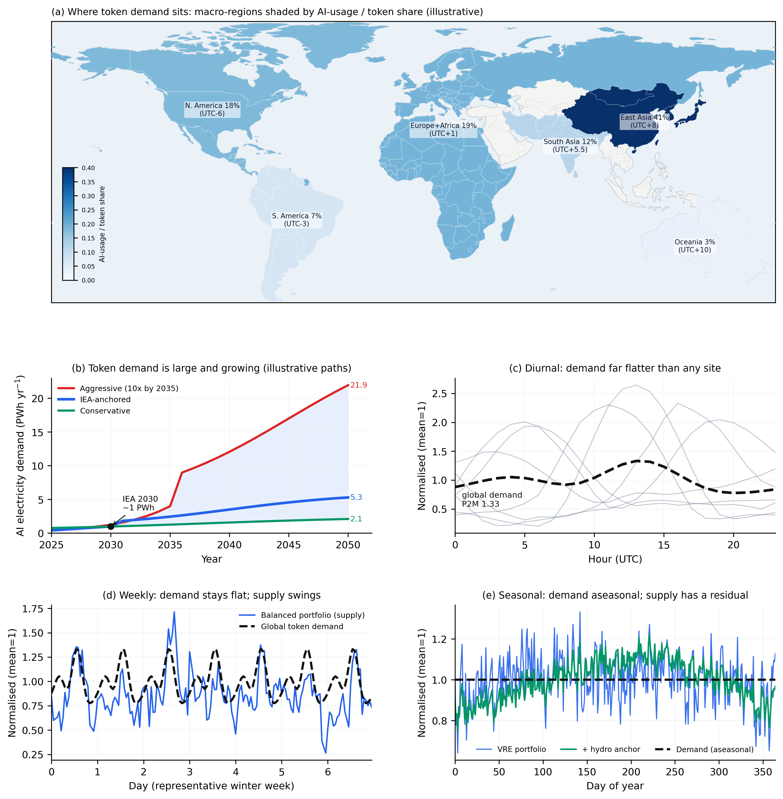
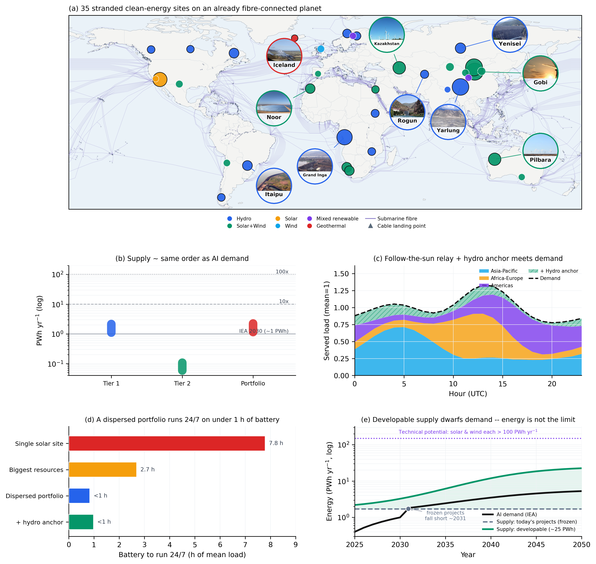
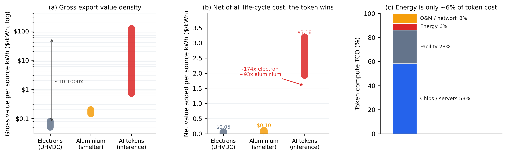
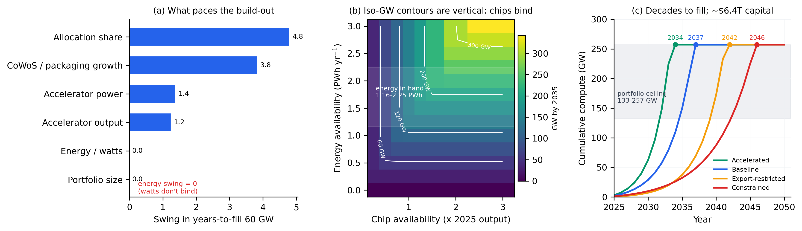

# 以全球 token 经济唤醒世界尚未开发的巨型能源资源

*（英文标题：Waking the world's untapped mega-energy resources through the global token economy）*

**作者：** [作者一]¹、[作者二]²　**单位：** ¹…；²…　**通讯作者：** …

---

## 摘要

最清洁、最廉价的电力正越来越多地被建在几乎无人能消纳之处——偏远巨型水电、沙漠风光与被弃电压减的既有风光电站，其总量已达一个主要经济体的全年用电量级。与此同时，人工智能催生出一种对用电地点异常不敏感的工业负荷：只要产出以 token（信息）而非电流形式搬运，便可在任何时区全天候被消纳。我们提出，对这类搁浅资源，价值最高的出口不是电子而是 token——在资源所在地部署推理算力、经光纤送出。该需求的全球昼夜峰均比仅约 1.33；沿经度分布的组合经"追日"接力，可使约 90% 的需求由同时段清洁供给直接满足而无需储能，做 24/7 所需电池也远少于单站。一度源电封装为 token 的可出口价值比电子高一到三个数量级；但全周期成本核算揭示：廉价电只把 token 成本降低个位数百分比，真正的赢点在于变现近零价值弃电、并省去特高压外送的巨资。决定建设节奏的约束既非能源亦非水，而是芯片。

---

## 正文

在世界各地，成本最低的清洁能源正被建在无人消纳之处。中国的雅鲁藏布江工程将在一处喜马拉雅峡谷中年发电约 300 TWh——约为三峡的三倍——而该地距负荷中心在 2000 公里以上¹,²。但它只是这一全球性格局中最极端的一例。刚果河上的大英加、从皮尔巴拉到哈萨克斯坦到纳米比亚的沙漠风光外送枢纽、戈壁可再生能源大基地，各自在远离负荷之处汇聚了数十到数百 TWh 的发电量；与此同时，中国西部、西得克萨斯、智利北部、南澳与苏格兰**既有的**风光电站，每年已以弃电形式弃掉两位数 TWh 的电量³。常规框架把这一切当作一个用更多线路去解决的输电问题。这一框架并非错误，但它正日益成为**错误的默认**——因为孕育出这些资源的同一个十年，也孕育出一种可以在别处消纳、并以信息形式送出的需求。我们因而把叙事倒过来：先问这种需求是什么，再问哪些搁浅资源能承接它、以何种形式承接最划算、以及究竟是什么在限制其建设。

我们提出四个递进的定量环节，每一环都为下一环扫清一个质疑：**需求**侧，AI 的 token 负荷巨大、全球、连续，且对地点不敏感（图 2）；**供给与匹配**侧，一个分层的全球搁浅组合在量级上与该需求比肩（图 3b），而一个沿经度分布的机群能以远少于任何单站的储能去跟随它（图 3c、d；Box 1）；**经济**侧，token 是价值密度与全周期成本双重最优的出口形式（图 4）；**约束**侧，决定建设节奏的是芯片与资本，而非瓦特（图 5）。

**图 1 ｜ 一个搁浅能源站点的三条出口路径。** 一个搁浅的瓦特可以电子离场（特高压线：高损、重资本、半径短、价值低）、以金属离场（铝："罐装电力"、可运、价值中等）、或以 token 离场（光纤：运输近零损耗、全球可达、价值密度最高）。概念示意图。

### 一种全球、连续、对地点不敏感的工业负荷

全球数据中心与 AI 用电正陡峭上升⁴：国际能源署（IEA）预测 2030 年 AI 用电约达 1 PWh/年，而更长期的外推情景把它推向数 PWh 乃至更高（我们给出三条明确标注为示意的轨迹，到 2050 年分别约为 2.1、5.3 与 21.9 PWh/年；图 2b）。其计量单位 token，既在总量上变得巨大，也第一次在能耗强度上变得可被可信地度量⁵,⁶。

但这一需求真正特殊之处在于其**时空结构**。其一，它**对地点不敏感**：只要工作负载可批处理、容时延——大规模预训练、批量与链式推理、合成数据生成、agentic 后台任务——便不取决于贴近用户，可被路由到任何有富余清洁电力之处。其二，它在时间上**无处不在**：推理在每个时区被全天候消纳。我们把六个宏观地区（北美、欧非、东亚、南亚、南美、大洋洲）按其 AI 用量份额加权²²⁻²⁵（图 2a），各地区当地昼夜活动（其形状由真实逐小时网络活动数据²⁶经验拟合，当地约 21:00 达峰、深夜见谷）再按各自时区错开叠加；所得全球需求包络的昼夜峰均比约 **1.33**，远平于任一单一地区（单站昼夜约 1.5–2.6；图 2c–e）——一个地区的傍晚峰值恰被另一地区的深夜低谷抵消。而 1.33 已是一个**保守**口径：这一日内形状并非臆测——它取自真实逐小时活动数据，且经真实 LLM 推理请求日志²⁷独立验证（其日内峰均比 1.69 与本文活动核 1.70 几乎一致、相位对齐后 Pearson 0.87；图 S2d）；况且我们是把它当作须**实时满足的刚性负荷**来计的，而这类工作负载本就可批处理、容时延、可主动错峰以贴合供给——真正运行时只会让匹配更易，而非更难。跨多个时间粒度看（图 2），需求日内起伏有限、几无季节性，只有一条缓慢上扬的多年增长线。正是这种"对地点不敏感、对时间连续"的双重性质，使后文"把分散的搁浅供给拼起来去跟随它"成为可能。

**图 2 ｜ token 需求巨大、全球、连续，且对地点不敏感。** （a）**需求所在地**：六大宏观地区按 AI 用量份额着色——东亚 41%（UTC+8）、欧非 19%（UTC+1）、北美 18%（UTC−6）、南亚 12%（UTC+5.5）、南美 7%（UTC−3）、大洋洲 3%（UTC+10）（2025 实测估计，东亚含中国国产模型口径）。（b）AI 用电多情景增长 2025→2050（PWh/年；三条示意轨迹 + 基线）。（c）日内：经度错开的各区需求叠成远平于单站的全球包络（峰均比约 1.33，单站昼夜约 1.5–2.6）。（d）代表性冬季周。（e）季节尺度：需求近无季节性，供给有残差。

### 一个与 AI 需求同量级的搁浅组合，与跟随它的全球机群

机会有多大？我们组建了一个分层的大型搁浅清洁能源组合（Box 1，共 35 个站点），并按一个就地共址的算力终端真正需要的标准筛选——容量因子、冷却气候、到光纤登陆点的时延、到基础设施的距离——所用方法沿袭文献⁷。**Tier 1** 为离散巨型项目（偏远巨型水电 + 规划中的沙漠外送枢纽），可搁浅合计约 1,100–2,150 TWh/年；**Tier 2** 为**既有的**、其产出今日已被弃掉的风光电站，弃电边际价值近乎为零，再添约 60–110 TWh/年。合计约 **1.2–2.3 PWh/年**——刻意不作夸张：这与 IEA 对 2030 年 AI 用电约 1 PWh/年的预测处于**同一量级**（约为其 1.2–2.3 倍；图 3b），理论沙漠潜力还要再大数倍⁷。我们的主张不是"单一资源压倒全世界"，而是：全球搁浅基底与它所能服务的需求处于同一数量级——于是，"下一批吉瓦级算力建在何处"的决定，隐含地就是"哪些搁浅的瓦特被变现"的决定。

而把这些资源接入需求所需的物理网络**已经存在**。海底与陆地光缆构成的骨干网已密布全球海岸（图 3a），把搁浅站点的连接问题化简为从登陆站到内陆站点的一段陆上光纤延伸——其每千米成本仅数万美元，与每千米数百万美元的输电走廊形成鲜明对照⁷,²¹。图 3a 把三件事叠在同一张世界地图上：资源质量、既有光纤连接、以及我们这 35 个具体候选站点。

**图 3 ｜ 一个沿经度分散、已被光纤接通的搁浅清洁能源组合，可跟随全天候的全球 token 需求。** （a）世界地图：底图为陆地资源容量因子，叠加海底光缆（TeleGeography）与登陆/互联点（PeeringDB）及 35 个组合站点（气泡面积=可搁浅电量，颜色=能源类型）；其中 10 个代表性站点以圆形实景照片标注，圆环颜色对应能源类型（照片来源与许可见补充信息）。（b）供给量级 vs AI 需求（对数纵轴，PWh/年）：Tier 1、Tier 2 与二者合计区间，对照 IEA-2030 及 10×/100× 参考线。（c）逐小时"追日"接力（横轴 UTC）：经度错开的清洁出力按三个经度带堆叠，其上再以水电锚点填平残余缺口、合起来顶到全球需求包络（黑色虚线）；约 90% 由同时段清洁供给直接满足、计入水电锚点约 93%，基本无需储能。（d）24/7 运行所需电池（按均荷小时数，取清洁供给恰等于平均需求的最严工况）：单一光伏站约需 7.8 小时，而沿经度分散的组合降至 <1 小时——做 firming 的是供给的分散度，而非电池容量。（e）可开发搁浅供给 vs 需求（对数纵轴）：仅当开发冻结于今日项目时供给才在约 2031 年短暂低于需求，持续开发则始终高于需求。数据来源与计算详见补充信息。

单一站点只看见自己的日照与风，而全世界的 token 需求并不受制于任一站点。这指向一个不同于"用储能把每个站点各自做成 24/7"⁷ 的解法：把供给沿经度分散，使**组合**——而非任何单站——去跟随这个遍布全球的负荷。基于跨越 −102° 至 +138° 经度的代表性站点的真实逐小时容量因子（ERA5 再分析¹⁴），我们构造了一个透明的"追日"接力调度。结果是：对一个可灵活路由、容时延的负载，全球全天候需求约 **90%** 可由**同时段**清洁供给直接满足、**完全无需储能**；若组合含一个稳定的水电锚点则升至约 **93%**（图 3c）；余下需求由可批处理缓冲在邻近时段消纳，仅约 0.1% 为真实缺口。一个独立的线性规划上界证实该结论稳健（接力规则达最优的约 **99.9%**），不依赖复杂优化器。

地理均衡本身就是一个比储能更便宜的设计杠杆。以光伏为主的单一站点日内峰均比约 2.6、昼夜起伏很大；而由同一批站点地理均衡构成的组合降至约 1.3——因为一个地区的午后正是另一地区的午夜。落到电池上：即便在"清洁供给恰等于平均需求"的最严工况下，单一光伏站做 24/7 仍需约 **7.8 小时**均荷电池，而沿经度分散的组合降至 **<1 小时**（图 3d）——做 firming 的是供给的分散度，而非电池容量；一个只向最大资源（恰好聚集于东半球）倾斜的组合平滑较少，约需 2.7 小时。多周尺度的**季节性**残差仍然存在——这是真正的局限——它不靠电池，而靠组合中稳定的水电成员与可批处理利用率的季节弹性来承担。

把这套匹配放到时间轴上看（图 3e），还要紧记一点：**搁浅供给的真正上限不是今日已点名的项目，而是未来可开发的清洁能源潜力**。文献给出的太阳光与风电**技术潜力各超过 100 PWh/年**、全部可再生能源达数百至上万 PWh/年，连计入成本的**经济潜力也已超过当前与近期需求**²⁸（图 3e）。因此"供给<需求"只在把开发**冻结于今日项目**时才出现（约 **2031** 年）；只要持续开发——其规模远在潜力之内、并由学习曲线式的成本下降与快速部署支撑²⁹,³⁰——搁浅供给就始终跟得上需求。换言之，在决定建设节奏的整个可见区间内，瓦特从不是那块短板，真正限速的是芯片与资本。

### token 为何是价值最大化的出口

远距离输电是一项工程奇迹；用于连接两个强电网时，它往往是正确的工具。然而，作为**为一个没有本地市场的资源变现**的手段，它带有三重结构性劣势：物理损耗（2000–3000 公里特高压外送通常损失 6–10%⁸,⁹）；资本固定而产品却是商品（一条数十吉瓦走廊是数百亿美元的专用资产，若以设计利用率的一半运行其单位成本大致翻倍，而电力送达时每源千瓦时仅约值 0.05–0.08 美元¹⁰）；以及时间（大型线路从核准到建成往往近十年，而并网排队中等待接入的发电与储能已超过 2 太瓦¹¹）。算力则把这一时间线反转——一座数据机房可在数月内通电。

变现搁浅电力的更老答案，是出口一种高耗能的**产品**。原铝是典范：Hall–Héroult 电解每千克金属耗电约 13–16 千瓦时，电力约占金属成本的 40%，铝实质上就是"罐装电力"¹²。这正是冶炼厂被刻意建在原本无法外销的水电旁的原因¹²,¹³。我们提出，数据中心就是现代冶炼厂，token 则是现代铝锭——而且密度高得多，并在脆弱性上发人深省地被**反转**了：电力占铝成本约 40%，却仅占算力成本约 4–7%⁵。这一点利弊两面：廉价电在 token 业务优势中所占份额更小，但也正因如此，这样的业务对能源价格是**稳健**而非脆弱的。

决定性的量，是每条出口路径把一度源千瓦时所封装的可售价值（图 4a）。以电子交付时约值 0.05–0.08 美元⁸,¹⁰；封装进铝时约值 0.14–0.20 美元¹²；转化为 token 时，一度电产出约百万到千万个 token，即便按 2026 年最低的约 0.4 美元/百万 token 售出，每源千瓦时毛价值也约为 0.7 美元，按前沿模型价格则高出一到两个数量级⁵,⁶。token 的毛价值密度因而比电子高出约**一到三个数量级**。

但成本侧给出一个更细、也更诚实的结论。我们自下而上核算了单卡算力的全周期成本（即全周期 token 成本，LCOT）：以单卡约 2 千瓦机房级功率、约 5 万美元全成本摊销，主流档（ε≈2 焦/token）的 token 成本约为 **0.73 美元/百万 token**，其中芯片与服务器约占 58%、设施约 28%、而**电力仅约 6%**。一个反直觉的推论随之而来：把电价从并网的约 60–90 美元/MWh 降到搁浅的约 20–46 美元/MWh，每百万 token 的成本只下降约 **3.1%**。换言之，搁浅资源的经济价值**并不在于让 token 更便宜**，而在于两件别处得不到的东西——把一大批本会被弃掉的清洁电力变现，以及省去以电子变现所必需的大规模输电建设。即便扣除掉支付芯片、设施与人力的那 93–95% 营收，每源千瓦时的残（净）值仍轻松超过一个被出口电子的全部到岸价值——按全周期净值计，token 约为电子的 170 倍、铝的 90 倍（因电子、铝的净值接近零，该倍数宜作量级理解，约 50–170×），并在几乎整个现实价格区间内胜过这两条路径（图 4c）。

**图 4 ｜ token 封装能源的价值远高于电子或金属，且净于其（最高的）转化成本仍胜出。** （a）每源千瓦时毛出口价值（对数）：电子约 0.05–0.08、铝约 0.14–0.20、token 约 0.7→123 美元。（b）算力拥有成本拆分：芯片约 58% / 设施约 28% / 电力仅约 6%；故搁浅 vs 并网电价仅降约 3.1% 成本。（c）每源千瓦时净值：token 约为电子的 170 倍、铝的 90 倍（量级估计；电子/铝净值近零）。

### 真正稀缺的是芯片，而非瓦特

那套让廉价电沦为次要成本优势的算术，也重置了约束之所在。约 1.2–2.3 PWh/年的组合相当于约 **130–260 吉瓦**的连续算力——需要约 6500 万到 1.3 亿张高端加速器（按每卡约 2 千瓦机房级功率¹⁵）——而全球高端加速器产量仅约 400–500 万张/年、且受先进封装产能所限¹⁶。即便把世界产量的五分之一拨给搁浅站点，每年也只能部署约 2 吉瓦算力：单个 10 吉瓦集群需约 5 年；填满 60 吉瓦需约 30 年、约 3000 万张加速器、约 1.5 万亿美元（约为大坝的 9 倍）；而填满整个资源基底是数十年的尺度。

这一约束的归属可由敏感性分析判决（图 5）。在"填满 60 吉瓦所需年数"这一指标上，逐一扰动各参数后排序为：**配置份额（摆动约 4.8 年）> 封装/CoWoS 增速（约 3.8 年）> 单卡功率 > 加速器产量**；而把**能源可得性**从 1.16 扫到 2.25 PWh/年，摆动恰为**零**——因为即便其低端（约 133 吉瓦潜力）也远超此处所要填满的 60 吉瓦。其影子价格同样悬殊：每多 1% 的全球加速器产量带来约 0.02 吉瓦/年的可部署增量，而每多 1 PWh 的能源带来约 0 吉瓦——能源在停止充裕之前，其部署边际价值为零。把这一点画成相图（图 5b），等吉瓦的等值线近乎**垂直**于能源轴：喂满即便最激进的芯片情景也只需约 3.9 PWh/年，远低于在手的 1.2–2.3 PWh。沿四种命名芯片情景外推至 2050，组合被**完全激活的年份**分别为约 2034（加速）、2037（基准）、2042（出口受限）与 2046（受限）。

因此先行者必然适度——数吉瓦与一个弃电资源就地共址，而非一次填满一座大坝。搁浅的瓦特是充裕的；消纳它的芯片才是稀缺的投入。

**图 5 ｜ 廉价搁浅电几乎不改变建设节奏；决定性约束是芯片、资本与爬坡。** （a）龙卷风敏感性：配置份额与封装增速主导"填满 60 吉瓦所需年数"，而能源/瓦特杠杆摆动为零。（b）二维相图：等吉瓦等值线垂直于能源轴——能源不约束、芯片约束。（c）四情景累计吉瓦至 2050（封顶于组合上限），以全激活年份区分。

### 什么必须成立，什么不必

该模式适配一大类且仍在增长的工作负载，且其条件已被若干资源满足。**可批处理、容时延**的工作并不取决于贴近用户，且仅推理类工况到 2025 年底就已超过用量的一半⁵。光纤增加的能耗可忽略，每千公里仅增数十毫秒时延，这类负载轻松容忍；寒冷与高海拔站点对冷却异常有利¹⁷；而比特币挖矿早已证明，算力会作为"最后买家"迁向伴生气、弃水电与过剩风电¹⁸。至于"为何不干脆建在需求侧"，其自然回应正是适用范围的界定：时延敏感与数据驻留型工作负载应当、也将会留在用户附近——我们的主张只是，那**可批处理**的一部分有一个强而被低估的理由迁向搁浅能源，且一流资源应在规划时把这一选项纳入视野。

### 供给侧风险与局限

决定性的风险在**供给**侧。第一也是最重要的是**时间可用性**：风光是间歇的，即便多元化组合也有同时段低谷；我们的匹配测算量化了残余稳供需求，但并未消除它。第二是**季节性与多日极端事件**——枯水、冬季光照低谷、多日"无风无光"，以及气候驱动的水文干旱——它们造成逐小时储能无法覆盖的持续缺口，转而落到稳定水电与季节性利用率弹性上。第三是**弃电作为资源的不确定性**：弃电按定义可变，且随电网加装储能与输电而萎缩，故按其规模建的算力必须可中断。第四是**物理与后勤**局限——地震灾害、冷却水稀缺、高海拔、极端偏远，以及把数百万张加速器运进这些地方的供应链问题；雅鲁藏布江站点——设计地震接近 8.5 级、近乎无路可达、且位于一条有争议的跨境河流上——正是这一类的极端实例，而非范本¹,²。第五，**对电网或化石兜底的依赖**会反噬"搁浅"与"清洁"两个前提。另有两点界定气候主张的边界：压低 token 价格可能因 Jevons 式反弹而扩大总能耗与硬件用量¹⁹；而要为"出口算力所封装的清洁能源"记账，需要一个尚不存在的碳核算框架²⁰。

### 展望

最清洁的能源正越来越多地搁浅在无人能用之处，而对它增长最快的需求却可以在任何地方被消纳、并以信息形式送出。两类量在规模上彼此匹配：我们组建的分层全球搁浅组合约 **1.2–2.3 PWh/年**，在能量上即为 IEA 对 2030 年 AI 用电预测（约 1 PWh）的约 **1.2–2.3 倍**；按主流单 token 能耗（ε≈2 焦/token）折算，足以封装约 **120–230 倍**于 2025 年全球 token 吞吐量（约 1.75×10¹⁶/年）的产出。当这两个事实相遇，一个搁浅瓦特的最优出口路径正日益是 token，一流的搁浅资源应被规划为算力终端——作为输电方案的补充乃至替代。由此有四步：各机构应发布"每源千瓦时到岸价值"度量，逐站点比较电子、金属与 token 三种出口，并延伸为一个给"被出口算力所封装的清洁能源"记账的碳核算框架；运营方应在一个**既有的**弃电可再生站点——西得克萨斯、智利北部或青海——试点一个吉瓦级、由弃电融资的推理集群，作为无需喜马拉雅大坝的近期验证；由于约束在硅，芯片厂商与政策制定者应把"算力建在资源处"当作芯片配置与出口管制问题；学界则应把"单 token 能耗"的透明披露标准化，因为正是这个参数主导了这里的每一个估计。铝曾教会二十世纪把搁浅的电力罐装外运；而在当下这十年，我们能用的最致密的那只"罐"，正是 token。

---

## Box 1 ｜ 一个分层的搁浅清洁能源资源组合

**Tier 1——离散巨型项目。** 偏远巨型水电（雅鲁藏布江约 270–300 TWh/年；大英加约 40–370；西伯利亚安加拉—叶尼塞梯级；丘吉尔瀑布）与规划中的沙漠外送枢纽（戈壁大基地约 450–900；皮尔巴拉约 80–90；Hyrasia 约 60–120；Hyphen 约 25–35）。可搁浅合计约 1,100–2,150 TWh/年。雅鲁藏布江是其中的极端成员——规模最大、且是冷气候高水头资源，但也兼具最大的地震、后勤与地缘难度——而非组织全文的核心案例。

**Tier 2——弃电电站群（今日被弃掉的电量）。** 中国西部、西得克萨斯、智利北部、南澳、苏格兰与伊比利亚的既有风光，今日已以近零边际价值弃掉约 60–110 TWh/年。总量小于 Tier 1，却已建成、已付清，是本论证最干净的近期案例。完整站点清单与筛选标准见补充信息与"代码与数据可得性"。

---

## 代码与数据可得性

支撑本文全部定量结果的分析代码及其输入与结果数据将于发表时在公共代码仓库公开，内容包括：分层搁浅组合的 35 个站点清单及筛选字段、代表性站点的逐小时容量因子序列、需求区域权重、时间匹配与接力分配结果、芯片约束与敏感性结果，以及全周期成本与盈亏平衡测算。第三方数据集（ERA5/Open-Meteo、TeleGeography、PeeringDB、Wikimedia、BurstGPT）依其各自许可获取并署名；完整方法见补充信息。

---

## 参考文献

*（被标为"重点"的参考文献按 Nature 体例加注一句意义说明。）*

1. Xinhua. Chinese premier announces construction of Yarlung Zangbo hydropower project. *Xinhua News Agency* (19 July 2025). https://english.news.cn/20250719/a2e4342fa63a492c95f646c73bd3313c/c.html
2. China's mega-dam on Yarlung Zangbo: a global game-changer in clean energy and regional cooperation. *CGTN* (22 July 2025). https://news.cgtn.com/news/2025-07-22/A-global-game-changer-in-clean-energy-and-regional-cooperation-1FdiEAtY0Ao/p.html
3. Ember. *China Energy Transition Review 2025* (Ember, 2025). https://ember-energy.org（底层弃电数据：国家能源局，2025 年上半年全国弃光率 6.6%、弃风率 5.7%；西藏弃风 30.2%、弃光 33.9%）。
4. International Energy Agency. *Energy and AI* (IEA, 2025).
**首个权威预测：数据中心与 AI 用电将在 2030 年前大致翻倍。**
5. You, J. How much energy does ChatGPT use? *Epoch AI, Gradient Updates* (2025).
**自下而上核算（约 2 焦/token；电力约占算力成本 4–7%），支撑价值密度、TCO 与芯片约束的定量核心。**
6. Oviedo, F. et al. Energy use of AI inference, efficiency pathways, and test-time scaling. *Joule* (2026). https://doi.org/10.1016/j.joule.2026.102430
**确立推理与测试时扩展会把单 token 能耗抬高一到两个数量级——即 ε 的上端。**
7. Zhu, Z., Yu, R., Chen, W.-Q. & Zhang, D. Desert power for the AI era. *Nexus* **3,** 100121 (2026). https://doi.org/10.1016/j.ynexs.2026.100121
**互补的供给侧分析：全球技术经济优化，表明离网沙漠风-光-储向就地共址数据中心交付 24/7 稳定电力；我们采用其筛选方法与连接性论据，并把其"逐站稳供"与我们的"分散组合匹配"相对照。**
8. DeSantis, D., James, B., Houchins, C., Saur, G. & Lyubovsky, M. Cost of long-distance energy transmission by different carriers. *iScience* **24,** 103495 (2021). https://doi.org/10.1016/j.isci.2021.103495
9. Alassi, A. et al. HVDC transmission: technology review, market trends and future outlook. *Renew. Sustain. Energy Rev.* **112,** 530–554 (2019). https://doi.org/10.1016/j.rser.2019.04.062
10. International Renewable Energy Agency. *Renewable Power Generation Costs in 2023* (IRENA, 2024).
**佐证中国大型水电（约 40 美元/MWh）是地球上成本最低的电力之一。**
11. Rand, J. et al. *Queued Up: Power Plants Seeking Transmission Interconnection* (LBNL, 2024).
**量化了输电而非发电已成为瓶颈步骤——这一时间不对称有利于"快建"的算力。**
12. International Aluminium Institute. *Primary Aluminium Smelting Energy Intensity* (IAI, 2023).
13. Skea, J. Electricity supplies for the primary aluminium industry. *Resour. Policy* **6,** 60–70 (1980). https://doi.org/10.1016/0301-4207(80)90007-0
14. Hersbach, H. et al. The ERA5 global reanalysis. *Q. J. R. Meteorol. Soc.* **146,** 1999–2049 (2020). https://doi.org/10.1002/qj.3803（逐小时数据经 Open-Meteo 档案 API 获取）。
**时间匹配分析中逐小时容量因子曲线的再分析数据来源。**
15. NVIDIA. *GB200 NVL72* (NVIDIA, 2024)（整机柜约 120 千瓦、72 张 GPU；机房级每卡约 2 千瓦，含 PUE 与网络开销）. https://www.nvidia.com/en-us/data-center/gb200-nvl72/
16. NVIDIA 数据中心 GPU 2023 年出货约 376 万张（≈98% 份额）(TechInsights, 2024)；TSMC CoWoS 先进封装月产能约 3.5 万→7.5 万片（2024→2025）、并将于 2026 年再约翻倍 (TrendForce, 2025). https://www.trendforce.com/news/2025/01/02/news-tsmc-set-to-expand-cowos-capacity-to-record-75000-wafers-in-2025-doubling-2024-output/
**确立：受封装产能所限的高端加速器产量，才是"把算力建在搁浅站点"的真正瓶颈。**
17. Google. *Environmental Report 2024* 与 *Data Center Efficiency*（2024 年全球机群 PUE 约 1.09）(Google, 2024). https://datacenters.google/efficiency
18. de Vries, A. Bitcoin's growing energy problem. *Joule* **2,** 801–805 (2018). https://doi.org/10.1016/j.joule.2018.04.016
19. Sorrell, S. Jevons' paradox revisited: the evidence for backfire from improved energy efficiency. *Energy Policy* **37,** 1456–1469 (2009). https://doi.org/10.1016/j.enpol.2008.12.003
20. Davis, S. J. & Caldeira, K. Consumption-based accounting of CO2 emissions. *Proc. Natl Acad. Sci. USA* **107,** 5687–5692 (2010). https://doi.org/10.1073/pnas.0906974107
21. TeleGeography. *Submarine Cable Map* https://www.submarinecablemap.com (CC BY-NC-SA)；PeeringDB（互联点与设施）https://www.peeringdb.com（访问于 2026）。
**图 3a 的光纤连接性数据来源；佐证"地球已被低成本光纤接通"。**
22. Anthropic. *Anthropic Economic Index report: Uneven geographic and enterprise AI adoption* (Anthropic, 2025). Preprint at https://arxiv.org/abs/2511.15080
**Claude.ai 各国使用份额（美 21.6%、印 7.2%、巴西 3.7%）与人均使用指数（与人均 GDP 强相关，~0.7%/1%）；图 2a 区域权重的一手锚点之一（单一厂商、单周快照）。**
23. Barenholtz, L. Top AI tools by web and app usage (August 2025 data). *Similarweb Blog* (Similarweb, 2025). https://www.similarweb.com/blog/marketing/seo/most-used-ai/（访问于 2026）。
**ChatGPT 各国网站流量份额（美 15.1、印 9.3、巴西 5.3、英 4.3、印尼 3.7、日 3.5、德 3.4、法 3.2、菲 3.0、加 2.6%；约 5.8B 访问/月）；图 2a 权重的消费侧锚点——为网站访问份额、非 token 量，且中国因屏蔽缺席。**
24. Chatterji, A. et al. *How People Use ChatGPT*. NBER Working Paper 34255 (National Bureau of Economic Research, 2025). https://doi.org/10.3386/w34255
**OpenAI 一手大样本：2025-07 时 18B 消息/周、7 亿用户（≈全球成人 10%），且低收入国增速最快——支撑需求的全球性与扩散方向。**
25. 国家数据局. 我国日均 Token 消耗量突破 30 万亿（截至 2025 年 6 月底；国务院新闻办公室新闻发布会，2025-08-14；日均调用量 2026-03 突破 140 万亿）. https://www.nda.gov.cn
**2025 年中全国日均 token 消费约 30 万亿（≈1.1×10¹⁶/年）、2026-03 约 140 万亿/天，几乎全部由国产模型（DeepSeek/Qwen/Doubao）承载——图 2a 东亚份额采用"全口径 token 需求"的依据。**
26. Wikimedia Foundation. *Pageviews Analytics / Wikistats REST API* (wikimedia.org/api/rest_v1, CC0)；逐小时浏览量按项目（ja、de 等单时区维基）聚合，访问于 2026。
**图 2c 日内活动核 a(h) 的经验拟合数据来源：真实、开放（CC0）、逐小时的人类网络活动代理，取代手设高斯。**
27. Wang, Y. et al. BurstGPT: a real-world workload dataset to optimize LLM serving systems. In *Proc. 31st ACM SIGKDD Conf. Knowledge Discovery and Data Mining* (2025). https://doi.org/10.1145/3711896.3737413（预印本 arXiv:2401.17644）。
**真实 LLM 推理请求日志（含 token 数与时间戳，约 143 万请求 / 61 天）；图 S2d 用其验证：真实 AI token 需求的日内峰均比（1.69）与本文人类活动核（1.70）几乎一致，形状相位对齐后 Pearson 0.87。**
28. Angliviel de La Beaumelle, N. et al. The global technical, economic, and feasible potential of renewable electricity. *Annu. Rev. Environ. Resour.* **48,** 419–449 (2023). https://doi.org/10.1146/annurev-environ-112321-091140
**图 3e 供给天花板的一手锚点：太阳光/CSP/陆上风/海上风技术潜力各 > 100 PWh/年，全可再生 164–27,200 PWh/年；且计入成本的"经济潜力"已超过当前与近期电力需求——即能源潜力远非约束。**
29. Way, R., Ives, M. C., Mealy, P. & Farmer, J. D. Empirically grounded technology forecasts and the energy transition. *Joule* **6,** 2057–2082 (2022). https://doi.org/10.1016/j.joule.2022.08.009
**确立太阳光/风/电池服从 Wright 学习曲线、成本随累计装机快速下降而部署加速——图 3e 供给增速所据的"快速转型"经验基础。**
30. International Energy Agency. *Net Zero by 2050: A Roadmap for the Global Energy Sector* (IEA, 2021)；及 *World Energy Outlook 2022* 更新版。
**机构净零情景：2050 太阳光约 15.5 TW（≈27 PWh/年发电）、风光合计约占发电 70%（≈45–50 PWh/年）——图 3e 供给扩建速率的部署锚点。**

*[投稿前扩充至约 40–50 条：补一手来源——token 吞吐量、中国特高压利用率、弃电统计、加速器产量与 HBM/CoWoS 产能、三峡对比、Hall–Héroult 热力学。]*

---

## 作者备注（不属于稿件）

- **投稿前待办：** (1) 用 `verify_citations.py` 把全部 ⚠ 行业/二手引用替换为一手文献；(2) 确认正文 ≤3,000 词、文献 ≤50、展示项 ≤6（Nature Energy 上限）；(3) 英文稿同步到 v3；(4) TeleGeography、Wikimedia 站点照片等第三方数据按许可署名；(5) 雅鲁藏布江一带**争议边界**按 Nature 中性制图政策处理（细灰边界 + 免责声明）。
