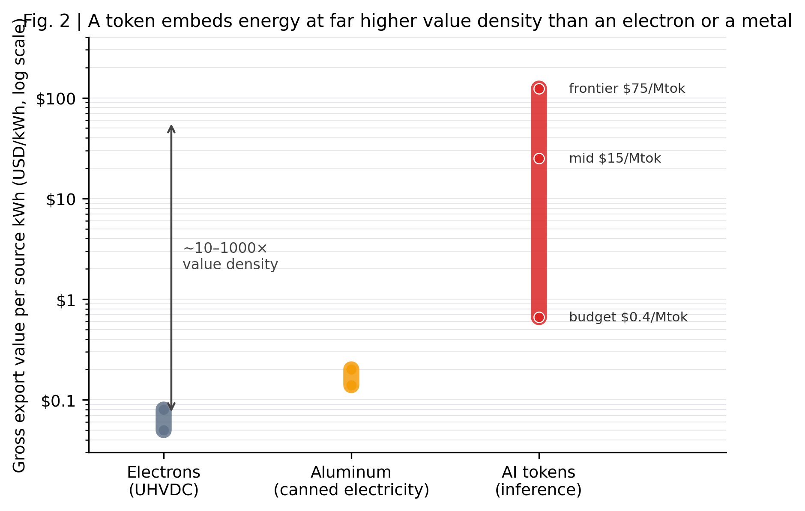
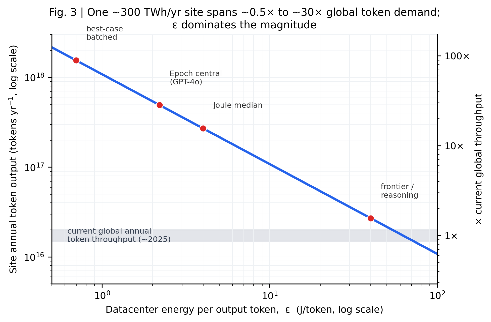
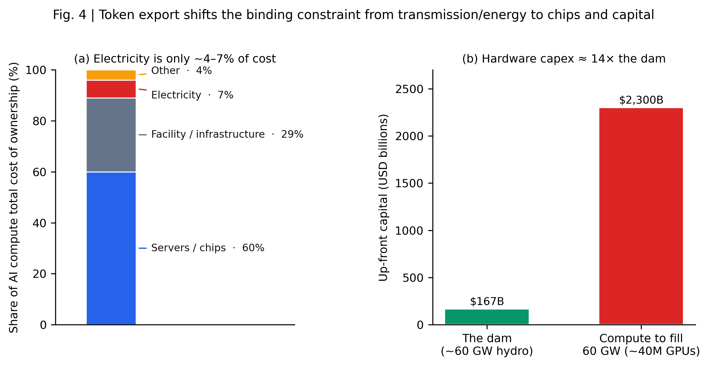
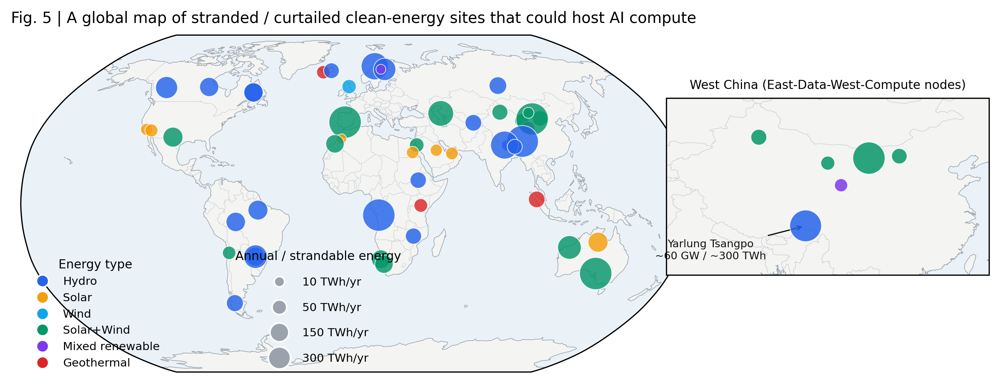

# 选题拓展（中文版）：把瓦特变成 Token —— 以算力出口替代搁浅清洁电力的外送

> **文档性质**：这是一篇面向 *Nature* 正刊 / *Nature Energy* 的 **Perspective（观点/展望文）** 的选题拓展与证据包。它不是最终稿，而是把你的想法打磨成"单一中心论点 + 新颖视角 + 时效性 + 直面反方"的可投稿骨架，并配齐核验过的数字、全球可类比站点清单、定量框架、图表与地图规划。
> **写作时请配合技能**：`nature-perspective`（体裁与结构）、`academic-paper`（学术英语与引文核验）、`academic-paper-figures`（出图与地图）。
> **数据出处**：所有关键数字均经独立对抗式核验，见文末「关键数据与来源」。站点地理数据见 [data/sites_master.csv](data/sites_master.csv)（50 个站点）。
> **更新日期**：2026-05-30。

---

## 0. 一句话中心论点（One central claim）

> **像雅鲁藏布江下游电站（约 60 GW、约 300 TWh/年）这样远离负荷、难以外送的搁浅清洁电力，最优的"出口形态"不是把电子通过高损耗的超长距离输电线送出，也不是任其弃电，而是在当地把电转化为 AI 推理（token）并经光纤出口——因为单位电力"封装"进 token 的价值密度，比电子或 20 世纪的"罐装电力"（铝）高出约 10–1000 倍。**

把它压成五个写作要素（Perspective 的五道门）：

| 要素 | 内容 |
|---|---|
| **中心主张** | 搁浅清洁电力应以 token 形式经光纤出口，而非以电子经输电线外送 |
| **新颖性** | 把"数据中心"重新定义为**能源出口终端**、把"token"定义为**迄今价值密度最高的储能载体**，将"把铝厂建在偏远水电旁"（冰岛、挪威）的百年逻辑延伸到信息时代 |
| **时效性** | ①雅江电站 2025-07 开工却未公布外送方案；②2025 上半年西藏弃风弃光率飙升；③单 token 能耗首次被自下而上测准（~0.3–4 J/token）；④全球 token 吞吐量刚越过 ~10¹⁶/年并数倍增长 |
| **证据脊柱** | 水电 LCOE、特高压损耗与成本、单 token 能耗、全球 token 量、铝业"罐装电力"先例（均见下文核验） |
| **最强反驳** | 主导成本是芯片折旧而非电费（能源仅占 TCO 的 4–7%），故这是**边际经济学的方向性主张**，受芯片/资本/地缘约束，而非"明天就拆掉输电线" |

---

## 1. 为什么这是一篇 Perspective（而不是 Review 或研究论文）

Perspective 体裁的两条铁律是**新颖性**与**时效性**，且必须有一个可被讨论、能被你用证据辩护的**单一主张**，并诚实直面最强反方。本选题天然契合：

- **它是一次"重新框定"，不是文献综述**：现有讨论要么把搁浅清洁电力当成"输电问题"（多建特高压），要么把 AI 的能耗当成"可持续性负债"（数据中心是要被减碳的负荷）。本文同时**反转两者**——数据中心是能源出口终端，token 是最高价值密度的能源载体。
- **它"现在"才成立**：直到 2025 年，单 token 能耗、搁浅资源规模、全球 token 需求**三个量级第一次同时大到、且被测准到可以直接比较**。此前没有任何 Perspective 做过这种定量比较。
- **它有立场、且能被反驳**：主张鲜明（"出口 token 而非电子"），但我们会用一整节直面"芯片才是瓶颈""时延敏感任务无法搬迁""固定水电有电网价值""地缘与跨境水安全"等最强反驳。

---

## 2. 目标期刊与篇幅

- **首选 *Nature Energy***（能源系统读者、重视带数据的前瞻框定，且其 Perspective 定义带"争议条款"——明确欢迎"有争议立场/思辨性假说"，正合本选题）；**备选 *Nature* 正刊**（更宽读者、更强"重新框定"叙事、最高声望）。
- **两刊精确规格（已核验）**：
  - ***Nature Energy***：正文 **≤3000 词**、参考文献 **≤50**、展示项 **≤6**（图/表）、短摘要无引用。**偏紧 → 论证必须精炼、能源中心**。
  - ***Nature* 正刊**：正文约 **3000–6000 词**（约稿时定）、非结构化摘要 ~150–200 词无引用、参考文献约 **50**、展示项 ~**4–6**；**特色要求：对最重要的 5–10% 文献各写一句加粗"意义注释"**。
  - 若需要更大篇幅/引文空间，*Nature Sustainability*（≤5000 词/≤60 refs）与 *Nature Computational Science*（≤4000 词/≤100 refs）是天然备选。
- **多为约稿**：投稿前先发 **pre-submission inquiry / 1–2 页 synopsis**（含中心论点、新颖性、一张示意图、关键近期文献）。
- 反推 house-style：用 `https://www.nature.com/nenergy/articles?type=perspective` 与 `…/nature/articles?type=perspective` 拉取两刊近年 Perspective。**本工作区已下载 10 篇范文**见 [references/](references/)（含 Nature Energy 的 CfD、天然气基础设施、煤改气三篇——结构与本选题高度同构）。

---

## 3. 定量框架（Quantitative framework）

把"搁浅 1 度电"沿三条出口路径追踪到"到岸可售价值"。

**符号与变量**

- $E$：站点年发电量（雅江：$E \approx 300\ \mathrm{TWh/yr} = 3\times10^{11}\ \mathrm{kWh/yr}$）
- $C_\mathrm{src}$：站点母线电价/LCOE（中值 \$0.04/kWh；区间 \$0.03–0.057）
- $\varepsilon$：数据中心层面**单 token 能耗**（J/token），**本分析最大的不确定性，跨度约 100 倍**
- $T = 3.6\times10^6 / \varepsilon$：每度电可产 token 数（tokens/kWh）
- $P$：token 市场价（\$/百万 token，2026：廉价 ~\$0.4、中端 ~\$15、前沿 ~\$75，且年降 ~80%）
- $G$：全球年 token 吞吐量（2025 末 ~$1.5\text{–}2\times10^{16}$/yr，数倍/年增长）

**三条出口路径**

1. **电子路径（特高压外送）**：到岸成本 $= C_\mathrm{src} + C_\mathrm{trans}$，其中跨 ~2500 km 损耗 ~6–10%、平准化输电成本 ~\$0.01–0.03/kWh（利用率敏感）。出口的是**商品化的一度电**，到岸价值 ~\$0.05–0.08/源 kWh。
2. **铝路径（罐装电力）**：1 度电 $\to$ ~69 g 铝（14.5 kWh/kg），可全球海运、运输几乎零能耗损失；出口价值 ~\$0.14–0.20/源 kWh（LME ~\$2600/t）。
3. **Token 路径（就地推理 + 光纤出口）**：1 度电 $\to T$ 个 token；电力仅贡献 $C_\mathrm{src}/T$ ≈ **\$0.024/百万 token**；按 token 价售出的毛价值 $= T\times P/10^6 = (3.6\times P/\varepsilon)\ \mathrm{[\$/kWh]}$。光纤运输能耗可忽略、时延仅每千公里数十毫秒、全球可达。

**站点年 token 产能与全球份额**

$$\text{tokens/yr} = E \times \frac{3.6\times10^6}{\varepsilon}, \qquad \text{全球份额} = \frac{\text{tokens/yr}}{G}$$

---

## 4. 雅鲁藏布江 / 墨脱 worked example（含敏感性）

**站点设定**：60 GW、300 TWh/yr（3× 三峡）、容量因子 ~57%、投资 ~RMB 1.2 万亿（~\$167 bn）、2025-07 开工、约 2033 投运、五级梯级、~2000 m 落差、抗震设防约 M8.5。西藏本地年用电仅 ~12–13 TWh（**不到电站产出的 ~4%**），最近的东部负荷中心 >2000 km，2025 上半年西藏弃风/弃光率已达 ~30%+ —— 也就是说，对潜在买家而言，**反事实里有相当一部分是"被浪费的电"，而非"可售的电"**。

**Step 1 — 电子路径**：跨 ~2500 km 特高压，损耗 ~8%（中值）；利用率 ~56% 时平准化输电成本 ~\$0.036/kWh ⇒ 到岸成本 ~\$0.063/kWh，卖出的只是商品电。为外送 60 GW 需多条 ±800–1100 kV 走廊（~\$0.6/W ⇒ 量级 **\$36 bn+** 专用线路），若利用率不足则线路本身搁浅。

**Step 2 — Token 路径**：电力仅贡献 ~\$0.024/百万 token；即便按 2026 最低价 ~\$0.4/百万 token 售出，毛价值已 ~\$0.66/源 kWh；中端 ~\$25/kWh；前沿 ~\$123/kWh。即使扣掉占营收 ~93–95% 的芯片/设施/人力，**残值/源 kWh 仍远超电子路径的 \$0.05–0.08**。

**Step 3 — 产能与全球份额（对 $\varepsilon$ 的敏感性，主导不确定性）**

| $\varepsilon$（J/token） | 工况 | tokens/kWh | 站点 tokens/yr | ÷ 全球年吞吐（~1.5–2×10¹⁶） |
|---|---|---|---|---|
| 0.7 | 极致批处理（最优） | 5.1×10⁶ | **1.5×10¹⁸** | ~30–86× |
| 2.2 | Epoch 中值（GPT‑4o 级） | 1.64×10⁶ | **4.9×10¹⁷** | ~10–27× |
| 4 | Joule 中位 | 9.0×10⁵ | **2.7×10¹⁷** | ~5–15× |
| 40 | 前沿/推理模型（悲观） | 9.0×10⁴ | **2.7×10¹⁶** | ~0.5–1.5× |

> **诚实的标题式结论**：以当今效率，这**单个站点**就能产出**相当于、乃至数十倍于全球当前年 token 总吞吐**的 token；即便在"前沿+推理"最悲观角落，也约等于"再造一个当前全球总量"。**主张方向稳健，量级由 $\varepsilon$ 主导。** （注：全球需求正数倍/年增长，到 2030 年若达 ~10¹⁸，则单站份额回落到个位数百分比——这条时间维度要在文中讲清。）

**Step 4 — 真正的约束在哪（破除幼稚解读）**：60 GW 算力 ≈ **~4000 万张 H100 级 GPU**、capex 量级 **~\$2.3 万亿**（约为大坝本身 \$167 bn 的 ~14 倍，且远超当前全球 AI 加速器年产）。故该站点不可能一次性填满，而是一个**受芯片供给/资本/地缘约束的 10–20 年算力建设过程**。正确解读是**方向性的**：边际经济学压倒性地favour出口 token，但可实现规模受制于硬件而非"瓦特的物理学"。

---

## 5. 价值密度对比表（文章的定量核心，建议做成 Figure 2）

| 出口载体（每 1 度搁浅清洁电） | 实际离场的东西 | "封装"开销 | 运输介质与损耗 | 每源 kWh 毛价值 | 相对电子的价值密度 | 关键约束 |
|---|---|---|---|---|---|---|
| **电子（特高压）** | 这度电本身 | 换流站+线损 6–10%/2000–3000 km | ±800–1100 kV 线；~3–3.5%/1000 km | ~\$0.05–0.08（到岸批发） | 1×（基准） | 线路 capex 固定；利用率 21–56% 使单位成本翻倍；另一端必须有需求 |
| **铝（Hall‑Héroult）** | ~69 g 金属（14.5 kWh/kg） | 电解即用途；~40% 金属成本是电 | 海运/铁路；运输近零损耗 | ~\$0.14–0.20（LME ~\$2600/t） | ~3× | 氧化铝/阳极/人力投入；金属价格周期；电价一旦不再便宜则崩溃（美国西北 1979–2001 十厂全停） |
| **AI token（推理）** | ~1.6 百万 token（@2.2 J/tok） | 数据中心开销已折进 J/token；电力仅占 TCO ~4–7% | 光纤；近零损耗，时延 ~数十 ms/1000 km | ~\$0.7（廉价 \$0.4/Mtok）→ ~\$25（中端）→ ~\$123（前沿） | **~10–1000×** | 硬件/芯片 capex 主导（~60% TCO）；芯片供给与地缘；时延敏感任务无法搬迁 |

---

## 6. 全球"搁浅清洁能源"版图与可类比站点（支撑全球叙事 + 地图）

你要求"多取一些类似地区并做地图"。我们已构建 **50 个站点**的可绘图清单（带经纬度/能源类型/装机/年电量/为何搁浅/数据中心适宜性/来源），见 [data/sites_master.csv](data/sites_master.csv)。它们分为四类叙事层级：

**Tier A — 偏远巨型水电（旗舰，"罐装电力"逻辑最强）**

| 站点 | 国家 | 坐标(lat,lon) | 装机 | 年电量 | 为何搁浅 |
|---|---|---|---|---|---|
| 雅鲁藏布江/墨脱 | 中国 | 29.46, 95.36 | ~60 GW（核验确认；或 60–81） | ~300 TWh | 距负荷>2000 km，本地需求~4%，未公布外送方案 |
| Grand Inga | 刚果(金) | -5.52, 13.62 | 远期 ~40 GW（现状~1.8） | 巨大 | 政治/输电缺失，几乎无本地负荷 |
| Churchill Falls | 加拿大 | 53.53, -63.97 | 5.43 GW | ~35 TWh | 拉布拉多无人区，被锁进 1969 低价长约至 2041 |
| GERD | 埃塞俄比亚 | 11.22, 35.09 | 5.15 GW（核验修正） | ~15 TWh | 区域负荷弱、互联有限、跨境争议 |
| Itaipu（巴拉圭份额） | 巴拉圭 | -25.41, -54.59 | ~7 GW（份额） | ~32 TWh 盈余 | 人口仅~7M，盈余低价让予巴西 |

**Tier B — 弃风弃光富集区（"算力作为可中断负荷"逻辑最强，分布式、地缘更温和）**

| 站点 | 国家 | 坐标 | 年弃电量/弃电率 | 数据中心适宜性 |
|---|---|---|---|---|
| 新疆（哈密/准噶尔） | 中国 | 43.8, 87.6 | ~10–18 TWh，光伏弃 12–18% | 凉夜冷冬、东数西算节点；缺水、夏热、供应链地缘风险 |
| 内蒙古（库布其/鄂尔多斯） | 中国 | 40.8, 109.8 | 绝对弃电量居前 | 冷干长免费冷却、近京光纤；缺水 |
| 甘肃河西走廊（酒泉） | 中国 | 39.7, 98.5 | ~5–10 TWh，原"弃风之都" | 廉价旱地；严重缺水 |
| 青海（塔拉滩/共和） | 中国 | 36.2, 100.6 | 光伏弃 15.2%(H1‑2025) | 高原凉爽、CSP+储可firming；海拔~3000m 削弱风冷 |
| 西得州 / ERCOT | 美国 | 31.8, -102.4 | ~8 TWh 弃电(2024)，午间负电价 | 易接入、地多、已有矿场；夏极热、缺水 |
| 阿塔卡马 | 智利 | -23.6, -69.0 | ~5.9 TWh 弃电(2024，~19%) | 全球最佳光照、午间近零电价；极端缺水、地震 |
| 南澳 | 澳大利亚 | -33.5, 138 | ~4.5 TWh 弃电(2024) | 全球最高瞬时可再生占比、午间负电价；电网小 |
| 苏格兰风电 | 英国 | 56.5, -3.0 | ~8.3 TWh GB 弃风(2024) | 凉爽海洋气候、强海缆光纤；电价高、并网排队 |

**Tier C — 沙漠/前沿太阳能巨项目（创纪录低价，但缺水/高热）**：摩洛哥 Noor/Xlinks、沙特 NEOM/Sudair、阿联酋 Al Dhafra、埃及 Benban、纳米比亚/南非绿氢区、澳大利亚 Sun Cable/Pilbara、蒙古戈壁、哈萨克斯坦。

**Tier D — 地热与高纬冷气候水电（已先行，免费冷却最佳）**：冰岛（地热+水电，已建数据中心与铝厂）、肯尼亚 Olkaria（微软/G42 已宣布地热 AI 数据中心）、印尼地热带、挪威/瑞典北部水电（Meta Luleå、Green Mountain）、加拿大 BC/曼尼托巴/拉布拉多、不丹/尼泊尔喜马拉雅水电。

> **关键洞见（写进文中）**：最便宜的搁浅电往往与"最差的水/偏远/时延"权衡同时出现（新疆、甘肃、青海、阿塔卡马）；而冷/高纬站点（北欧、加拿大、冰岛、苏格兰）虽电量较小却**天然适合免费冷却**。雅江同时具备"巨量+高原冷凉+落差"，但叠加**地震、跨境水、芯片物流**的极端约束——既是最强案例，也是最强反例，正适合 Perspective 的张力。

### 地图设计建议（见 Figure 5 / 地图）
- **世界地图**（建议 Robinson 或 Equal Earth 投影），50 个站点为气泡：**气泡大小 = 可外送/弃电的 TWh/yr**，**颜色 = 能源类型**（水电/光伏/风/光风/地热）。
- 叠加**对比性箭头**：从站点出发，红色短箭头="电子经特高压（高损、短半径）" vs 绿色长箭头（贯穿全球）="token 经光纤（全球可达）"。
- **中国/西藏内插图（inset）**：突出雅江旗舰案例与东数西算节点（新疆/甘肃/青海/内蒙）。
- 工具：本工作区 `academic-paper-figures` 技能默认要求地图用 **frykit**（偏中国底图）。**全球底图建议改用 cartopy**——这需要你一句话授权放宽（见文末「下一步」第 5 条）。

---

## 7. 完整文章大纲（可直接进入写作）

> 体裁=论证型 Perspective：无 Methods/Results，全篇为"论点+证据+反驳+展望"。每节先抛领域级子主张，再用数字佐证，末句桥接下一节。

**标题（≤12 词，主张前置）**：*Export the watt as a token*（中文工作名：把瓦特变成 token）。副标/导语：搁浅清洁电力应以 AI 推理经光纤离场，而非以电子经线缆。

**摘要（~180 词，非结构化，无引用）**：四段式弧线——①利害：世界正在远离需求的地方建 ~60 GW/300 TWh 的水电，西藏弃电已 30%+，默认答案是数千公里高损耗特高压；②主张："Here we argue"出口搁浅清洁电的最高价值方式是就地转为 AI token 经光纤出口；③证据：电力仅占算力成本 ~4–7%、~\$0.024/百万 token，token 封装能源的价值密度是电子或"罐装电力"铝的 10–1000 倍，按实测效率单站即可产出相当于乃至数倍全球当前年 token 量；④含义：把顶级搁浅能源站点当作算力终端，约束随之从输电转为芯片与资本。

**引言（无小标题，四步阶梯）**：背景+锚点（雅江 300 TWh/yr ≈ 2024 全球数据中心用电的相当比例，却在 >2000 km 外、地震峡谷中，本地仅用 ~12–13 TWh）→ 传统框定（外送问题、靠特高压/西电东送）→ **Why now**（开工无外送方案 + 2025 弃电飙升 + 单 token 能耗已测准 + 全球 token 越过 10¹⁶/年）→ 明确主张（"Here we argue…"）+ 路线图段落（点名五节）。

**§1 搁浅电的难题：为什么"移动电子"是错误的默认**
子主张：超长距离电子外送高损、重资产、依赖对端需求、利用率长期偏低。证据：特高压损耗 6–10%/2000–3000 km、换流站占成本约 1/3、**线路 capex 固定 ⇒ 单位成本随利用率反比放大**（中国早期特高压利用率 21–56%、仅约 20% 输送的是可再生）。给出到岸成本 \$0.053–0.074/kWh，且卖出的只是商品电。桥接：历史上有"把能源做成更高价值产品出口"的先例。

**§2 Token 是 21 世纪的"罐装电力"（重新框定 + 历史类比）**
子主张：文明一直靠把搁浅电嵌入可运产品来变现；token 是迄今密度最高的那种产品。类比：铝=凝固的电（13–16 kWh/kg、~40% 成本是电、铝厂特意建在偏远水电旁——冰岛~64–72% 国家电力供电解铝、挪威、魁北克、Kitimat、美国西北 Bonneville）。**类比的警示另一半**：美国西北模式在电价不再便宜后崩溃（电价+250%，2001 年前十厂全停）——就地能源出口产业"成也廉价电、败也廉价电"，而这正是搁浅巨型水电赋予的比较优势。把数据中心重新定义为能源出口终端。桥接：量化让 token 与众不同的价值密度。

**§3 为什么 token 胜出：定量核心**
子主张：每源 kWh，token 价值是电子或铝的 10–1000 倍，且电力只占 token 成本极小份额。给出框架：tokens/kWh 来自 $\varepsilon$（0.7–70 J/token）；电力仅贡献 \$0.006–0.44/百万 token vs 市价 \$0.40–180/百万 token；电力占 TCO ~4–7%（硬件 ~60%）。放**价值密度阶梯图**（电子 \$0.05–0.08；铝 \$0.18；token \$0.7–123）与**雅江 worked example 全敏感性**（~2.7×10¹⁶ 到 1.5×10¹⁸ tokens/yr ⇒ ~0.5× 到 ~30× 全球）。标题以区间陈述，点明 $\varepsilon$ 为主导不确定性。**关键图在此节。**

**§4 可行性：什么条件必须成立**
子主张：对**时延不敏感、可批处理**的工作负载，该模式在物理与运营上可行。使能条件：高原冷凉免费冷却（Google Hamina PUE 1.09 类比）、光纤近零能耗且仅数十 ms/千公里时延（适合批量推理/训练/agentic/推理链/合成数据）、算力作为可中断/位置无关负荷的先例（比特币挖矿作为弃电/伴生气的"最后买家"——Crusoe >250 MW、ERCOT 柔性负荷、得州风电挖矿研究）。诚实缺口：高原水/冷却、地震（近缝合带 M8.5 设防）、把数百万 GPU 运进地球最难抵达地区之一的物流。桥接：但最深的反驳是经济与地缘。

**§5 反驳、边界与风险（专章，体裁的credibility来源）**
以最强形式陈述并"先承认后界定"：①硬件而非能源主导（~\$2.3T/~4000 万 GPU ⇒ 约束是芯片/资本/时间，主张是边际经济学、跨越数十年，而非一键替换）；②为何不建在需求侧？（放弃了廉价搁浅电与省下的输电，且要挤占拥堵电网与并网排队——但赢在时延/人才/供应链/分散地缘风险）；③时延敏感任务无法搬迁（承认；只有可批处理部分合格，但该部分大且随推理/agentic 增长——2025 末推理类已超 50% 用量）；④固定水电有电网价值（有真实机会成本，但此处本地需求仅 ~4%、弃电 30%+，电网价值多为名义）；⑤水/冷却、地震、海拔；⑥Jevons/回弹（廉价 token 可能扩大总需求与总能耗，而非减少足迹）；⑦算力地缘（在单一国家控制、跨境河流上集中前沿算力，叠加出口管制、数据主权、单点失效、下游水安全——同一 token 出口逻辑在得州/智利/魁北克/北欧等分布式搁浅可再生站点更温和，应作为可推广的一般情形）。不把任何反驳驳到零；展示主张在**有界包络**内存活。

**结论 / 展望（无小标题）**
重申意义：瓦特最佳的出口路径正日益变成 token；顶级搁浅能源资源应被规划为算力终端，与输电并列乃至取代之。给出**点名责任主体的、可证伪的下一步**：①电网规划者/IRENA 应发布"每源 kWh 到岸价值（电子 vs token vs 金属）"逐站点指标；②运营商应在某弃电可再生站点（得州/智利/青海）以**弃电融资的 GW 级推理集群**做验证试点；③芯片厂/政策制定者应把"算力建在资源处"作为芯片配置与出口管制问题；④**标准化透明的 J/token 披露**，以收敛主导本分析的 $\varepsilon$ 不确定性。结尾呼应开篇"把瓦特变成 token"，并用时间地平线为最大胆的愿景设界（"within this decade"）。

---

## 8. 图表与地图规划（≤5 展示项）

| 编号 | 类型 | 一句话信息 | 所需数据 | 出图工具 |
|---|---|---|---|---|
| **Fig 1** | 概念图（视觉摘要） | 一个搁浅站点的三条出口路径：电子（高损线缆/低值）、金属（罐装电力/中值）、token（光纤/最高密度） | 三路径的损耗、价值/源 kWh 注解 | 概念示意（in-house 重绘） |
| **Fig 2** | 价值密度阶梯（对数轴） | token 价值密度是电子/铝的 10–1000 倍 | §5 表的数值 + 假设带 | matplotlib（柱/区间） |
| **Fig 3** | $\varepsilon$ 敏感性 | 在实测 0.7–70 J/token 区间，单站产出 ~0.5×–30× 全球年吞吐：方向稳健、量级由 $\varepsilon$ 主导 | tokens/yr = 300 TWh×3.6e6/ε；全球分母带 1.8e16–5e16 | matplotlib（阴影区间） |
| **Fig 4** | 成本结构/约束转移 | 电力仅 4–7% TCO、芯片 ~60% ⇒ 约束从输电/能源转为硬件/资本/芯片 | Epoch TCO 拆分；60 GW⇒~4000 万 GPU/~\$2.3T vs \$167B 坝 | matplotlib（堆叠柱+注释） |
| **Fig 5 / 地图** | 全球站点地图 | 全球搁浅清洁能源版图 + 电子 vs token 出口半径对比 | [data/sites_master.csv](data/sites_master.csv)（50 站点） | **cartopy**（全球）+ 中国 inset；需放宽 frykit 约束 |
| **Box 1** | 文字框（200–500 词） | 雅江/墨脱项目速览（规模/位置/时间线/外送难度/弃电背景） | §4 设定数字 | — |

---

**已渲染图**（英文标注、出版级、PNG 300dpi + 矢量 PDF；绘图脚本 [figures/make_figures.py](figures/make_figures.py) 可复现/微调）：

**Fig 1｜一个搁浅能源站点的三条出口路径**（电子/铝/token；右侧价值密度 ~10–1000×）。

**Fig 2｜价值密度阶梯**（电子/铝/token，对数轴）。

**Fig 3｜单 token 能耗 ε 敏感性**（单站 ≈0.5×–30× 全球年 token 量）。

**Fig 4｜算力成本结构与约束转移**（电力仅 4–7%、芯片 ~60%）。

**Fig 5｜全球搁浅/弃电清洁能源站点地图**（cartopy + 中国内插，50 站点）。

---

## 9. 关键数据与来源（均经独立对抗式核验；标注可信度与待核验项）

**已核验（高可信，见 [data/wf1_verdicts.json](data/wf1_verdicts.json) 完整推导与多源链接）**

1. **雅江/墨脱**：~60 GW（最常引用的保守规划值，部分权威分析给 60–80 GW；官方未公布确切总装机）、~300 TWh/yr（≈3× 三峡）、~RMB 1.2 万亿、2025-07-19 开工、约 2033 投运。来源：[Wikipedia: Medog Hydropower Station](https://en.wikipedia.org/wiki/Medog_Hydropower_Station)、[POWER Magazine](https://www.powermag.com/china-breaks-ground-for-worlds-largest-hydropower-station/)、[Jamestown: *Yarlung Tsangpo Hydropower Fuels PRC's Energy‑Computing Strategy*](https://jamestown.org/yarlung-tsangpo-hydropower-fuels-prcs-energy-computing-strategy/)、[The Diplomat](https://thediplomat.com/2026/02/whats-driving-chinas-mega-medog-hydropower-project/)。
2. **大水电 LCOE**：全球加权均值 ~\$57/MWh（2023）；**中国大水电 ~\$40/MWh，全球最低区之一**；项目级跨度 ~\$20–190/MWh。来源：[IRENA Renewable Power Generation Costs 2023](https://www.irena.org/-/media/Files/IRENA/Agency/Publication/2024/Sep/IRENA_Renewable_power_generation_costs_in_2023_executive_summary.pdf)、[IRENA Hydropower Costs](https://www.irena.org/costs/Power-Generation-Costs/Hydropower)。
3. **特高压直流**：±800 kV 线损 ~2.5–3.5%/1000 km + 换流站 ~1.4–1.6%（与距离无关）⇒ 2000–3000 km 总损 ~6–10%；平准化输电成本 ~\$0.01–0.03/kWh（利用率敏感）。**注：1.5%/1000 km 是 ±1100 kV 昌吉‑古泉的最优值，非"特高压"通例。** 来源：[Wikipedia HVDC](https://en.wikipedia.org/wiki/High-voltage_direct_current)、[World Nuclear Association](https://world-nuclear.org/information-library/current-and-future-generation/electricity-transmission-grids)、[DeSantis et al., iScience 2021](https://pmc.ncbi.nlm.nih.gov/articles/PMC8661478/)、[Xiangjiaba–Shanghai HVDC](https://en.wikipedia.org/wiki/Xiangjiaba%E2%80%93Shanghai_HVDC_system)。
4. **单 token 能耗 $\varepsilon$**：典型优化推理 ~0.3–4 J/token（数据中心层；~0.9–12 百万 token/kWh）；GPU‑only 最优 ~0.15–0.4 J/token；**前沿/推理模型 40–120 J/token（高 1–2 个量级）**。中值锚点 ~2.2 J/token（Epoch GPT‑4o）。来源：[Epoch AI](https://epoch.ai/gradient-updates/how-much-energy-does-chatgpt-use)、[*Where Do the Joules Go?* arXiv 2601.22076](https://arxiv.org/html/2601.22076v1)、[TokenPowerBench arXiv 2512.03024](https://arxiv.org/html/2512.03024v1)、[Joule 2026](https://www.cell.com/joule/fulltext/S2542-4351(26)00114-5)。
5. **全球 token 年吞吐 $G$**：2025 末 ~1.5–2×10¹⁶/yr（落在 10¹⁶–10¹⁷ 区间下沿），数倍/年增长（Google 18 个月 ~130×）。来源：[Tomasz Tunguz](https://tomtunguz.com/trillion-token-race/)、[Fireworks/Menlo](https://fireworks.ai/blog/state-of-agent-environments)、[Google Cloud Q2‑2025](https://blog.google/company-news/inside-google/message-ceo/alphabet-earnings-q2-2025/)。
6. **铝=罐装电力**：电解 ~13–15.5 kWh/kg（全球均 ~14.1）；冰岛/挪威历史上把铝厂建在偏远水电以变现搁浅电（冰岛 ~70% 电力供电力密集工业）。来源：[International Aluminium Institute](https://international-aluminium.org/statistics/primary-aluminium-smelting-energy-intensity/)、[Hall‑Héroult, Wikipedia](https://en.wikipedia.org/wiki/Hall%E2%80%93H%C3%A9roult_process)、[Askja Energy](https://askjaenergy.com/iceland-renewable-energy-sources/hydro-and-geothermal-history/)。

**待复核（综合阶段引入、尚未单独对抗核验，写作前需核实）**：①2025 上半年西藏弃风 30.2%/弃光 33.9% 的确切口径与来源；②Google 月 token 量的最新值与"窗口期口径"问题；③Epoch 的 TCO 拆分（服务器 60%/设施 29%/能源 4–7%）原文；④美国西北铝业 1979–2001 崩溃的具体数据；⑤"~20% 特高压输送为可再生""中国早期特高压利用率 21–56%"的原始出处。

> 站点级数据见 [data/sites_master.csv](data/sites_master.csv)（50 站点，含来源链接）；多为二手聚合源（Ember/EIA/AEMO/Modo/IRENA 级较强，省级/北欧较弱），投资用途前请核对一手监管/运营商数据。

---

## 10. 写作下一步建议

1. **确认目标刊**：*Nature Energy*（建议）vs *Nature* 正刊——影响摘要风格与读者面（我已按通用 Nature 家族搭好，可微调）。
2. **先写 §3 定量核心与 §5 反驳**（论证与数字最重处），再回写引言/结论（这是 `nature-perspective` 技能推荐的顺序）。
3. **核验「待复核」五项**并补足参考文献到 60–100 条（用 `academic-paper` 的 `verify_citations.py`）。
4. **出图**：Fig 2/3/4 + Box 可直接用现有数字；**地图 Fig 5** 需你授权"全球底图用 cartopy（而非 frykit）"，我即可调 `academic-paper-figures` 出英文版世界地图（气泡=可外送 TWh、颜色=能源类型、电子 vs token 出口半径对比、中国 inset）。
5. **英文成稿**：本中文版定稿后，按 Nature 学术英语转写为投稿英文版。

---

### 开放问题（可作为"未来方向"与审稿预判）
- 前沿/推理工况的真实产线 $\varepsilon$ 是多少、降得多快？（跨度 ~100×，主导一切结论；标准化 J/token 披露是最高价值的缺失数据）
- 全球 token 需求中真正"时延不敏感、可搬迁"的份额有多大、如何随 agentic/推理增长？
- 在什么到岸电价与输电距离下，token 出口在"每 kWh 到岸价值"上胜过电子出口？各真实站点（西藏/得州/智利/青海/北欧）的交叉点在哪？
- 芯片供给/资本/施工物流能否在大坝 ~2033 投运的时间尺度上，向偏远高震高原交付哪怕数 GW 算力？
- 本地需求微小但可能增长时，固定水电的电网价值如何对算力定价？什么"算力+选择性电子外送+储能"混合最优？
- 在单一国家控制的跨境河流巨站集中前沿算力前，需要什么治理/出口管制/跨境水框架？分布式搁浅可再生站点是否在拿到大部分价值的同时规避这些风险？
