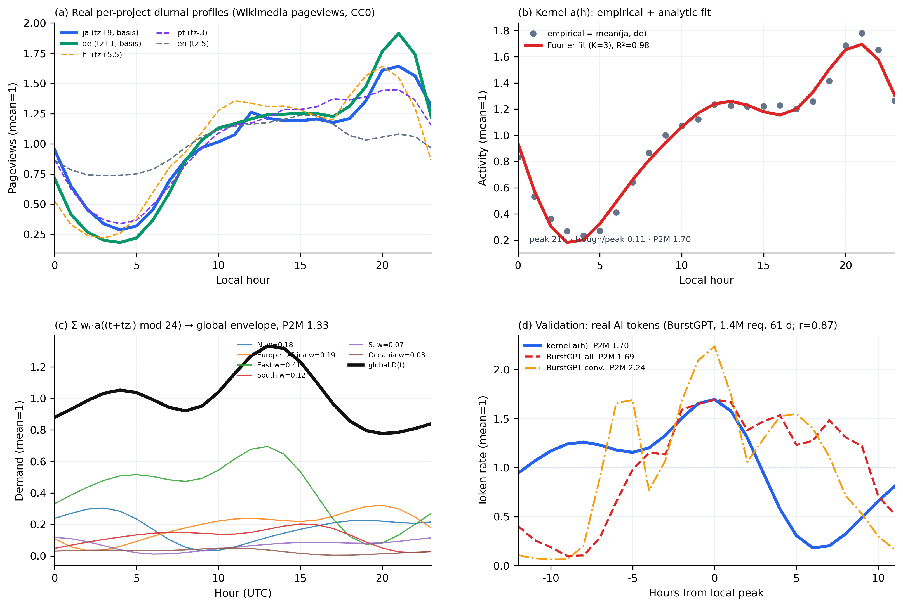

# 补充方法

《以全球 token 经济唤醒世界尚未开发的巨型能源资源》一文的可复现方法。所有结果均由 `analysis/` 中的脚本重新生成，脚本将机器可读的结果写入 `data/*_results.json`；图件由 `figures/make_figures.py` 渲染。运行顺序：

```
python analysis/portfolio_demand.py        # M1  -> data/portfolio.csv, portfolio_demand_results.json
python analysis/lifecycle_cost.py          # M4  -> data/lifecycle_results.json
python analysis/gpu_constraint.py          # M3  -> data/gpu_constraint_results.json
python analysis/fetch_diurnal_wikimedia.py # M2  -> data/diurnal_kernel.json   （拟合 a(h)；需联网）
python analysis/temporal_matching.py       # M2  -> data/temporal_matching_results.json, temporal_profiles.json
python analysis/validate_diurnal_ai_traces.py  # M2 验证 -> data/diurnal_ai_validation.json（下载 BurstGPT）
python figures/make_figures.py             # 图 1–5、Box 1、图 S1；图 S2 由 figS2_diurnal() 生成
```

## S1. 组合与需求情景（M1）

**组合。** 我们从一次覆盖 50 个站点的全球扫描（`data/sites_master.csv`）中整理出一份分层清单（`data/portfolio.csv`），对每个站点记录其*可搁浅*能量区间（TWh/年）——即无本地市场或本地市场薄弱、可外送/被弃掉的那一部分，**而非**总发电量——同时记录类型、状态、坐标、平准化度电成本（LCOE）区间及来源行。**Tier 1** = 离散的搁浅巨型项目（偏远巨型水电 + 规划中的沙漠外送枢纽）。**Tier 2** = 既有的、其产出今日已被弃掉的风光电站（边际价值近乎为零）。被标记为 `theoretical` 的行（如约 2,600 TWh/年的蒙古戈壁潜力）仅作为上界报告，并从头条的"现实"汇总中剔除。筛选标准沿袭 Zhu 等（文献 8）：年容量因子、环境温度/冷却适宜性、到光纤登陆点的往返时延、到道路/基础设施的距离。

**汇总。** 各层求和得：Tier 1 现实值约 1,103–2,147 TWh/年，Tier 2 约 59–107 TWh/年，组合现实值约 1.16–2.25 PWh/年。

**需求情景。** 用电情景锚定于 IEA《Energy and AI》（2025）对 2030 年的预测（约 1 PWh/年），以及文献 8 的 10× 与 100× 情景。token 等价换算采用单 token 能耗 ε，实测区间 0.15–120 焦（中位约 2 焦）：tokens/年 =（PWh/年 × 3.6×10¹⁸ 焦/PWh）/ ε。2025 年全球吞吐量区间为 1.5–2.0×10¹⁶ tokens/年。结果：组合约为 IEA-2030 用电需求的 1.2–2.3 倍；按中位 ε 计约为 2025 年 token 吞吐量的 100–230 倍。

## S1b. 完整全周期成本与价值（M4）

对每条出口路径，我们按每**源**千瓦时搁浅清洁能源计算其**净增加值** = 毛产出价值 − 非能源全周期成本（发电母线 0.02–0.04 美元 + 转化资本/运维 + 运输/损耗）；源能量本身即为被变现的搁浅资源。**电子：** 经 6–10% 损耗后交付的商品价值为 0.05–0.08 美元/千瓦时，再减去平准化输电附加 0.01–0.03 美元 → 净值约 −0.02 至 0.05 美元。**铝：** 1 千瓦时 → 1/(13–16) 千克；毛值 = 千克数 × 2.3–2.6 美元/千克 = 0.14–0.20 美元；再减非能源成本（氧化铝原料 + 电解厂资本/运维 + 海运，约 1.2–2.0 美元/千克）→ 净值约 −0.05 至 0.11 美元。**token：** 关键恒等式是——每源千瓦时的非能源全周期成本 = p_elec·(1−s)/s，其中 s 为电力在算力总拥有成本（TCO）中的份额（4–7%）、p_elec ≈ 0.03 美元/千瓦时——该式**与 ε 无关**，约为 0.4–0.7 美元/源千瓦时。对*净值*核算，每源千瓦时毛值 =（3.6×10⁶/ε）× 价格，在三个耦合的（ε，价格）档位上评估（经济档 ε=0.5 焦、0.4 美元/百万 token；主流档 ε=2 焦、2 美元/百万 token；前沿档 ε=40 焦、30 美元/百万 token）→ 三档的净增加值均约为 1.9–3.2 美元/源千瓦时。而图 4a 中头条的*毛价值密度*则是在高效 ε=2 焦下对价格（0.40–68 美元/百万 token）作扫描——只扫一个量（产出价格），其性质与电子、金属的价格扫描相平行；token 远更宽的区间反映的是 token 价格真实存在的 2–3 个数量级的跨度，而非双轴叠加的人为产物。因此 token 净值比电子或金属高出约一到两个数量级（约 90–170×）。**该倍数是脆弱的：** 电子与铝的净值中点都跨越零（电子 −0.02..+0.05；铝 −0.05..+0.11），故母线/输电假设的微小变化即可使其摆动；应将其理解为"数量级"，而非精确值。token 之所以胜出，是**尽管**它的转化成本最高（正是这一资本密集性后来变成芯片约束，见 S3）。由 `analysis/lifecycle_cost.py` → `data/lifecycle_results.json` 复现；见图 4。

**token LCOT 成本栈（图 4b）。** token 的成本数字是一个完整的**总拥有成本（TCO）**，而非仅芯片成本。LCOT 在**设施层级**按单卡自下而上构建（`analysis/lifecycle_cost.py` → `data/lcot_breakdown.json`）。摊销后的年成本栈（美元/年·卡）：加速器 + 服务器资本 **12,500 美元**（= 5 万美元整机系统全成本按 4 年摊销；区间 3–5 年）· 设施资本/运维 **6,000 美元** · 运维/人力 **1,400 美元** · 网络/光纤 **350 美元** · **能源** = P × 8,760 小时 × 利用率（0.90）× 电价。吞吐量为 tokens/年 = P × 3,600 × 8,760 × 利用率 / ε。在并网电价（中位约 0.075 美元/千瓦时）下能源项约 1,180 美元/年，成本栈合计约 21,400 美元/年，即**芯片/服务器 58% · 设施 28% · 运维 6.5% · 网络 1.6% · 能源 5.5%**（在 60–90 美元/MWh 区间内能源占 4.5–6.5%）。在 ε = 2 焦（主流）下 LCOT 约 0.73 美元/百万 token，而从并网电改用搁浅电（20–46 美元/MWh）只把 LCOT 降低约 3.1%。该百分比构成**与 ε 无关**：非能源成本栈与基于功率的能源项都是按"每卡每年"计的，故 ε 只重新标定 tokens/年（从而 $/百万 token），不改变各项份额。

**冷却已被计入——而且在两处。** （i）*冷却用电*位于能源行：每卡功率 **P = 2.0 千瓦为设施层级的取电功率**（区间 1.7–2.7 千瓦），即它已在芯片本身消耗的约 0.7–1.4 千瓦之上嵌入了数据中心的 PUE（约 1.2–1.4），因此冷机/CRAH 机组/风扇所取用的功率是被计量并计价的（文献 16；见 S3）。（ii）*冷却的资本与非能源运维成本*（冷机与排热，连同建筑外壳与配电）位于设施资本/运维行（6,000 美元/年，约 28%）。这一设施数字是一个**集总**值，经标定使整个成本栈再现已发表的自下而上推理-TCO 分解（芯片/服务器约 60% · 设施约 29% · 能源 4–7%；文献 6），而非逐台冷机的逐项搭建——应将这 28% 理解为"建筑 + 配电 + 冷却的合计"。更热或更干的站点会把 PUE 推高，从而在能源行与设施行之间转移成本，但头条结论（能源约占 TCO 的 6%；搁浅电相对并网电仅省约 3%）基本不变，恰恰因为无论哪种情形下能源都只占 TCO 的一小部分。

## S2. 逐小时时间匹配（M2）

**供给。** 代表性站点（经度 −102° 至 +138°）的逐小时天气取自 ERA5 再分析（Hersbach 等 2020），经免费的 Open-Meteo 档案 API 获取 2023 整年（8,760 小时，UTC），缓存于 `data/cache_openmeteo/`。换算：

- *光伏容量因子*：CF = clip(GHI/1000, 0, 1) × PR，其中短波辐射 GHI（瓦/平方米）、性能比 PR = 0.85。
- *风电容量因子*：对 100 米风速 v 采用通用功率曲线——切入风速 3 m/s 以下为 0；以 (v³−3³)/(12³−3³) 立方爬升至额定 12 m/s；至切出风速 25 m/s 维持 1.0；以上为 0。
- *站点出力* = w_solar·CF_solar + w_wind·CF_wind（各站配比不同）。*水电*（雅鲁藏布江锚点）按稳定出力建模，平均 CF 0.55、±18% 季节调制（不抓取天气）。

每个站点曲线归一化为单位均值。**均衡组合**为各站等权平均（刻意作经度铺展）；另报告一个**按可搁浅量加权**的组合（权重 ∝ 可弃电/可搁浅 TWh）以作对照。**+水电**组合按其可搁浅权重掺入稳定锚点。

**需求包络。** 不存在公开的逐小时全球 token 需求序列；我们*构造*一条，并标注其为"示意但有据"。UTC 下的全球需求为 D(t) = Σ_regions w_r · a((t + tz_r) mod 24)，其中 a(h) 为当地小时活动核，**由真实逐小时维基百科浏览量经验拟合**（不再是手设高斯；见下文*日内活动核*）。各地区（时区偏移、AI 用量权重 w；默认"全口径"情景）：东亚（+8，0.41）、欧非（+1，0.19）、北美（−6，0.18）、南亚（+5.5，0.12）、南美（−3，0.07）、大洋洲（+10，0.03）。权重 w **依 2025 年使用数据估计**而非手设（见下文*需求权重估计*）。该包络无季节性。其日内峰均比约 1.33（仍远平于任一单一地区的 2.6–3.8），因为各地区峰值被经度错开。

**需求权重估计（图 2a）。** 无公开来源给出六大宏观地区的 token 量份额，故权重 w_r 由 2025 年实测代理三角定位，并报告为两套情景（均为示意、量级口径）。*输入：* Anthropic 经济指数（2025 年 9 月）——Claude.ai 各国份额：美 21.6%、印 7.2%、巴西 3.7%，使用量 ∝ 人均 GDP（文献 23）；Similarweb（2025 年 8 月）——ChatGPT 网站流量份额：美 15.1%、印 9.3%、巴西 5.3%、英 4.3%、印尼 3.7%、日 3.5%、德 3.4%、法 3.2%、菲 3.0%、加 2.6%，约 58 亿次访问/月，中国因 ChatGPT 被屏蔽而缺席（文献 24）；OpenAI/NBER 工作论文 34255——180 亿条消息/周、截至 2025 年 7 月 7 亿用户、低收入国采用增速最快（文献 25）；以及中国国家数据局——2025 年中约 30 万亿 token/天（约 1.1×10¹⁶/年），几乎全部由国产模型承载（文献 26）。*方法。*（i）将西方平台的各国份额聚合进六大宏观地区并归一化 → **消费侧**情景（中国约 0）：北美 0.25、欧非 0.28、东亚 0.16、南亚 0.17、南美 0.10、大洋洲 0.04（日内峰均比 1.21）。（ii）中国国产模型需求对那些西方平台代理而言不可见，但其量级与一家主要西方厂商相当；故在**全口径**情景（默认）中，把约占全球 token 需求 30% 的中国加到东亚地区，并将其余地区按 0.70 缩放 → 东亚 0.41、欧非 0.19、北美 0.18、南亚 0.12、南美 0.07、大洋洲 0.03（日内峰均比 1.33）。*稳健性。* 在**两套**情景下，头条的路由同时段满足率均约为 0.90（纯清洁）与 0.93–0.94（+水电）——即在东亚份额 0.16–0.41 的整个范围内对中国份额都不敏感——因为同时段满足取决于供需的时序，而非各地区的绝对权重。这些权重仍为示意：网站访问份额 ≠ token 量、厂商数字为单月建模估计、且中国份额（主导敏感性者）本身不确定。复现：`AI_DEMAND_INCLUDE_CHINA={1,0} python analysis/temporal_matching.py`。日内*形状* a(h) 现已经验拟合（见*日内活动核*），非臆测。

**日内活动核（图 2c；构建过程见图 S2a–c）。** 当地小时活动核 a(h) 拟合自真实、开放、逐小时的数据而非假设。我们查询 Wikimedia Pageviews REST API（aggregate、all-access、agent=user；CC0；文献 27）中两个最"纯"的单时区维基百科——ja（JST = UTC+9）与 de（CET = UTC+1；取 2 月窗口，无欧洲夏令时）——覆盖四个完整周（2026 年 2 月），按当地小时分箱、在窗口内平均、各自归一化为均值 1、再取二者平均；以截断傅里叶级数（K = 3 个谐波）拟合，R² = 0.98。该经验核在当地约 21:00 达峰、深夜见谷（谷/峰 ≈ 0.11）——与此前手设的高斯（峰 16:00、谷/峰 ≈ 0.47）显著不同：真实峰值晚约 5 小时、夜间谷深得多。交叉核对：hi（IST）与 pt（BRT）再现了傍晚达峰的形状；en（全球、多时区）相对平直（谷/峰 0.60），印证了单时区选择。代入该经验核后，全球包络的日内峰均比由高斯下的约 1.13 / 1.09 升至 1.33（全口径）/ 1.21（消费侧），并把 +水电同时段满足率由 0.94 降到 0.93；纯清洁同时段满足率（0.90）及全部储能/分散结果不变。注意：浏览量是**人类**网络活动代理、非实测 AI 推理，且语言↔地区的对应只在单时区项目上才干净；因此该核是一个*保守*的日内形状——真正可批处理/容时延的 AI 负载会更平、而非更尖——故它从上方界定了日内摆幅。复现：`python analysis/fetch_diurnal_wikimedia.py` → `data/diurnal_kernel.json`。

**日内活动核——显式计算。** 步骤（脚本 `analysis/fetch_diurnal_wikimedia.py`）：**(i) 逐项目曲线**——对每个项目，当地小时曲线 p̂(h) = p(h) / ⟨p⟩，其中 p(h) 是 4 周窗口内当地小时箱 h = ⌊(hour_UTC + tz_proj) mod 24⌋ 的逐小时浏览量均值（图 S2a）；**(ii) 核**——â(h) = ½[p̂_ja(h) + p̂_de(h)]，重归一化为单位均值；**(iii) 解析拟合**——最小二乘截断傅里叶级数（图 S2b）

&nbsp;&nbsp;&nbsp;&nbsp;a(h) = c₀ + Σ_{k=1..3} [ αₖ·cos(2πkh/24) + βₖ·sin(2πkh/24) ]，

拟合所得 (c₀, α₁, β₁, α₂, β₂, α₃, β₃) = (1.00, −0.119, −0.519, 0.090, −0.319, −0.032, −0.100)，R² = 0.98（峰 21:00 当地、谷/峰 0.11、单地区峰均比 1.70）。**(iv) 叠加**（图 S2c）——全球包络 D(t) = Σ_{r=1..6} w_r · a((t + tz_r) mod 24)，归一化为单位均值（日内峰均比 1.33）。**(v) 同时段满足**——路由同时段满足率 = Σ_t min(S(t), D(t)) / Σ_t D(t)，其中 S(t) 为缩放至 ⟨S⟩ = ⟨D⟩ 的清洁供给序列。**(vi) 验证曲线**（图 S2d）——真实 AI 的 token 加权逐时直方图 T(h) = Σ_{请求 i：⌊ts_i/3600⌋ mod 24 = h} tok_i（归一化为单位均值），与 a(h) 在 24 个相移上取最大圆 Pearson 相关后比较。

**对真实 AI token 的验证（图 S2d）。** 由于该核是人类网络活动代理，我们以真实大模型推理日志对其交叉核对——BurstGPT（文献 28；61 天内 140 万请求、含逐请求 token 数；CC-BY-4.0）。真实 AI 推理的 token 加权逐时曲线日内峰均比为 **1.69——与该核的单地区峰均比 1.70 几乎完全一致**——且具相同的宽白天/深夜谷形状（相位对齐后 Pearson **0.87**）。BurstGPT 是单一聚合服务，无地理字段、时区未披露，故只比较形状与幅度，不比较绝对相位或逐地区份额。值得注意的是，仅含对话（人类交互）的子集*更尖*（峰均比 2.24），而以 API/批处理为主的总体更平（1.69）——这直接支持本文论点：可批处理、容时延的 AI 负载会平抑日内摆幅（故该核是保守而非乐观的选择）。复现：`python analysis/validate_diurnal_ai_traces.py` → `data/diurnal_ai_validation.json`。



**图 S2 ｜ 日内需求核 a(h)：构建、拟合、叠加与验证。** **(a)** 真实逐项目当地小时浏览量曲线（Wikimedia，CC0）：单时区项目 ja/de（核的基础，加粗）与 hi/pt 均在当地约 20–21:00 达峰、有深夜谷；多时区项目 en 相对平直（它在多个时区上平均），印证为何采用单时区项目。**(b)** 经验核 â(h) = mean(ja, de)（点）及其截断傅里叶拟合（K = 3，R² = 0.98；峰 21:00 当地、谷/峰 0.11、单地区峰均比 1.70）。**(c)** 经度叠加 D(t) = Σ wᵣ·a((t + tzᵣ) mod 24)：六个加权地区贡献（细线）叠成全球包络（粗黑线；日内峰均比 1.33）——错开的当地峰值部分填补了彼此的谷。**(d)** 对真实 AI 推理 token 的验证（BurstGPT，140 万请求、61 天）：token 加权日内曲线（峰均比 1.69）在幅度与形状上匹配该核（1.70）（峰对齐后 Pearson 0.87）；仅含对话（人类交互）的子集更尖（峰均比 2.24），而以 API/批处理为主的总体更平——与"可批处理、容时延的 AI 负载平抑需求"一致。BurstGPT 无地理字段，故它验证的是核的形状/幅度，而非逐地区权重。

**储能度量。** 对一个等于平均供给的平直（24/7）负荷，无损水库需求为 (供给 − 需求) 累积和的跨度（max − min），以平均负荷的小时数报告。*日内*储能隔离平均日循环（电池）；更大的*季节性*残差（数周尺度）单独报告，且不属于电池职责——它由稳定水电与季节性利用率弹性承担。**路由同时段满足率**为 Σ min(供给, 需求)/Σ 需求：对一个可在日内自由跟随盈余的负荷，由同时段清洁供给直接满足的需求份额。

**头条结果。** 日内峰均比：单一光伏站 2.64 → 均衡组合 1.27 → +水电 1.12（需求 1.33，"全口径"情景，经验核）。日内储能：9.2 小时 → 1.5 小时（减少 6.2 倍）；仅最大资源时为 2.9 小时。路由同时段满足率：0.65 → 0.90 → 0.93。

## S3. 芯片约束（M3）

参数（中位；区间见代码）：每张高端加速器设施层级功率 2.0 千瓦（1.7–2.7）；全成本 5 万美元（系统）/ 3 万美元（芯片）；2025 年全球高端加速器产量约 5×10⁶ 张/年（2023 年数据中心 GPU 约 376 万张），随 CoWoS 封装产能以约 1.35×/年增长；雅鲁藏布江参考成本 1,670 亿美元。组合的连续等效算力 = PWh/年 × (10¹⁵/8760/10⁹) GW ≈ 133–257 GW。填满 C GW 所需加速器 = C×10⁶/功率。产量份额 s 下年可部署 GW = 产量 × s × 功率 / 10⁶。填满所需年数 = 目标 / 年可部署量。结果（20% 份额）：年可部署 2.0 GW；10 GW 约需 5 年；60 GW 约需 30 年（约 3000 万张加速器、约 1.5 万亿美元、约为大坝的 9 倍）；填满整个组合约 66–129 年；2025–2035 累计约 149 GW。

## S4. 方法的局限

- 需求包络的日内*形状*现已对真实逐小时网络活动数据（Wikimedia 浏览量——人类活动代理，非实测 AI 推理；见 S2）经验拟合，而地区*权重*依 2025 年使用数据估计（Anthropic 经济指数、Similarweb、OpenAI/NBER、中国国家数据局；S2）——二者仍为量级口径。定性结果（全球需求远平于任一单一地区；组合日内储能 ≪ 单站；同时段满足率约 90%/93%）对情景选择（消费侧 vs 含中国的全口径）稳健；具体百分比为示意。
- ERA5 单年（2023）曲线略去年际变率；故季节性残差储能是多年最坏情形的下界。
- 可搁浅能量区间整理自二手来源，投稿前应以一手项目数据替换/同行核对。
- GPU 产量与封装产能数字变动很快；应作为区间处理，并在投稿时更新。
